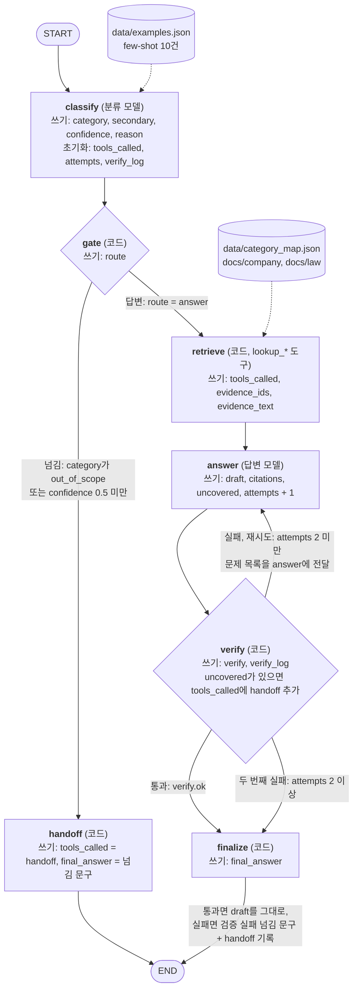
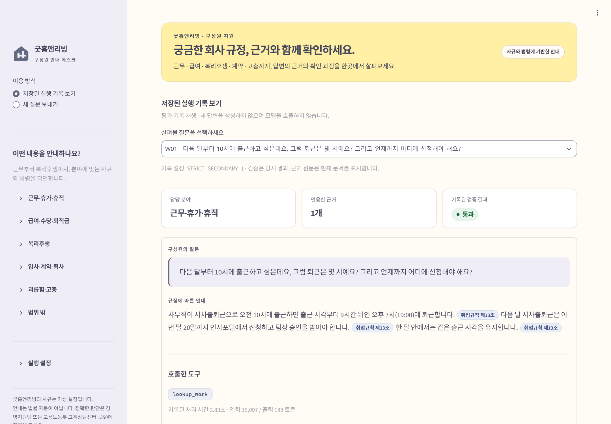
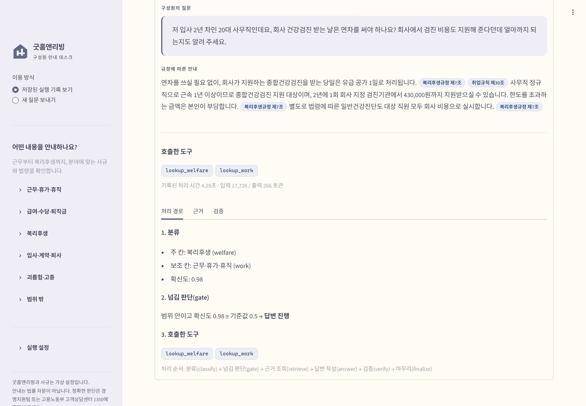
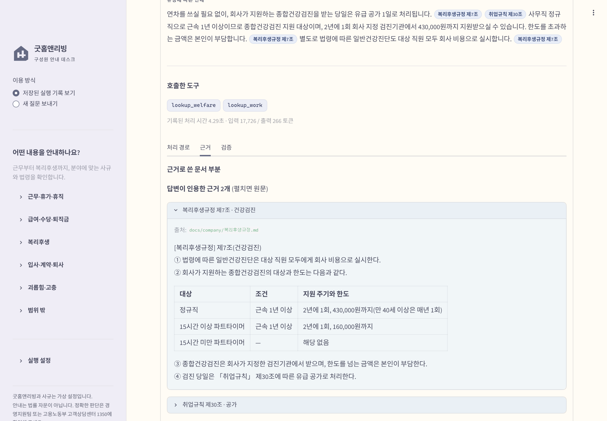
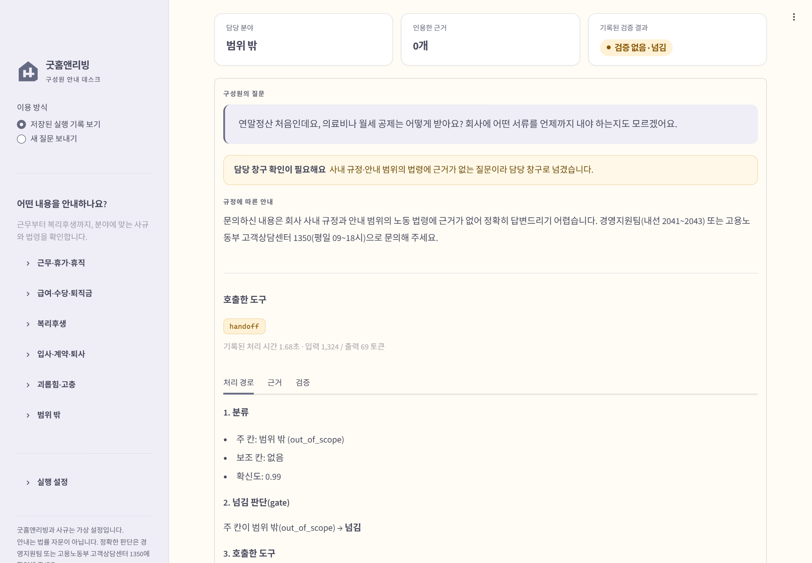
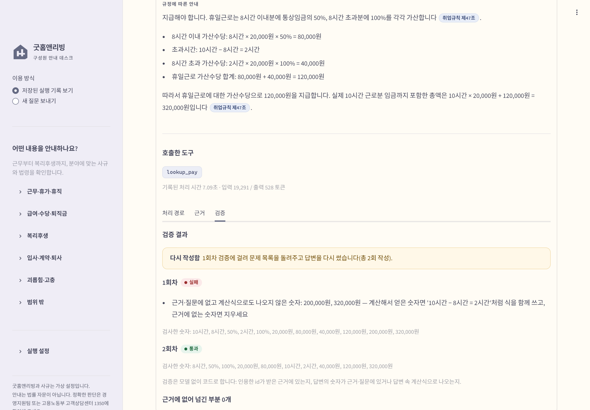

# 굿홈앤리빙 노동 문의 라우팅 에이전트 — 보고서

직원의 노동 문의를 담당 칸(카테고리)으로 나누고, 그 칸의 근거만 프롬프트에 넣어 답한 뒤, 답변을 코드로 검증하는 LangGraph 에이전트를 만들었다.

> 굿홈앤리빙은 실존 회사와 무관한 가상 회사다. `docs/company/`의 사규도 이 프로젝트를 위해 새로 쓴 가상 규정이다. 법령은 국가법령정보센터의 현행 조문 원문이다.

| 절 | 내용 | 상태 |
|---|---|---|
| 1 | 주제와 근거 문서 | 작성 |
| 2 | 카테고리 설계 | 작성 |
| 3 | 평가셋 설계 | 작성 |
| 4 | 측정 결과 | 작성 |
| 5 | 파이프라인 구조도 | 작성 |
| 6 | 데모 설계 | 작성 |
| 7 | 프로젝트 회고 | 작성 |

---

## 1. 주제와 근거 문서

### 1.1 주제: 회사 직원의 노동 문의 상담

"우리 회사에서는 이 경우 어떻게 되나요?"라는 직원 질문에, 회사 사규와 노동 법령을 근거로 답하는 사내 상담 창구를 주제로 정했다.

| 판단 기준 | 이 주제가 맞는 이유 |
|---|---|
| 근거 원문을 구할 수 있는가 | 법령은 국가법령정보센터에 현행 조문이 공개돼 있고 저장소에 그대로 넣을 수 있다 |
| 칸과 근거를 깔끔하게 이을 수 있는가 | 취업규칙은 장(章) 단위로, 법령은 조(條) 단위로 나뉘어 있어 "이 칸 = 이 장 + 이 조문들"로 매핑표를 만들 수 있다 |
| "말하면 안 되는 답"을 만들 수 있는가 | 노동 분야는 잘못 알려진 상식(옛 법 기준, 흔한 관행 값, 정규직 기준을 알바에게 그대로 적용 등)이 많아 금지 표현을 만들기 좋다 |
| 평가셋을 채울 만큼 질문이 다양한가 | 같은 조문도 사무직·매장 직원·파트타이머·인사 담당자가 서로 다른 입장에서 묻는다. 40~50건을 겹치지 않게 만들 수 있다 |
| 칸 사이 경계가 적당히 헷갈리는가 | 야간수당(근무 ↔ 급여), 못 쓴 연차(근무 ↔ 급여), 경조휴가와 경조금(근무 ↔ 복리후생)처럼 혼동 행렬에서 볼 거리가 있다 |

**검토했다가 고르지 않은 주제**

| 후보 | 고르지 않은 이유 |
|---|---|
| 소비자 분쟁 상담(소비자분쟁해결기준) | 업종별로 너무 깔끔하게 갈려 혼동 행렬에서 분석할 거리가 적다 |
| 기차 이용 안내(여객운송약관) | 근거 문서가 약관 하나뿐이라 칸을 나눌 근거가 약하다 |
| AI 숏폼 크리에이터 정책 문의 | 정책 페이지가 자주 바뀌고 원문을 저장소에 넣어도 되는지 애매하다 |
| 홈패브릭 상세페이지 문의 | 이전에 만든 RAG 프로젝트와 문서가 겹친다 |
| 주택 임대차 상담 | 후보로 검토했으나 위 기준에서 노동 상담보다 앞서지 않았다 |

### 1.2 사용자(페르소나)

주 사용자는 **입사 1~3년 차 사회초년생 직장인**으로 정했다. 다만 인사 담당자, 매장 파트타이머의 질문에도 답할 수 있게 범용으로 만들었다.

- 주 사용자를 정해 두면 평가셋의 말투와 비중을 정할 수 있다.
- 같은 조문을 근로자·회사·단시간 근로자가 서로 다른 입장에서 묻기 때문에, 사용자층을 넓혀도 근거 문서는 거의 늘지 않는다.
- 사용자층이 넓어지면서 생기는 갈래(주 15시간 미만 파트타이머의 적용 제외)는 2.4절에서 다룬다.

### 1.3 왜 법령만이 아니라 "가상 회사 사규"를 주 근거로 했나

처음에는 법령만 근거로 쓰려 했다. 그런데 법령만 쓰면 **모델이 이미 외운 내용과 근거에서 읽은 내용을 구분할 수 없다.** 연차 15일, 야간 가산 50% 같은 값은 근거를 안 넣어도 모델이 답한다. 그러면 "그 칸의 근거만 넣는다"는 설계가 실제로 효과가 있는지 측정할 수 없다.

그래서 가상 회사의 사규를 **주 근거**로, 노동 법령을 **보조 근거**로 정했다.

| 장치 | 효과 |
|---|---|
| 회사 고유 숫자를 흔한 관행 값과 일부러 다르게 정했다 | 근거를 읽었는지, 짐작으로 지어냈는지가 답에 바로 드러난다 |
| 연차 일수, 출산전후휴가·배우자 출산휴가·육아휴직 기간은 사규에 "법령에 따른다"로만 적었다 | 이런 질문은 사규와 법령을 함께 읽어야 답할 수 있다 |
| 회사 규모를 정했다(상시 약 80명) | 5인 미만 사업장 같은 적용 범위 갈래가 사라진다. 근로기준법이 전부 적용된다 |

회사 고유 숫자의 예는 다음과 같다.

| 항목 | 굿홈앤리빙 사규 값 | 흔히 짐작하는 값·법정 기준 |
|---|---|---|
| 야간 가산율 | 통상임금의 60% | 법정 50% |
| 결혼 경조휴가 | 6일 | 관행 5일 |
| 식대 | 월 187,000원 | — |
| 급여일 | 매월 23일 | — |
| 퇴직금 지급 기한 | 퇴직 후 10일 이내 | 법정 14일 |
| 매장 파트타이머 기본 시급 | 10,790원 | 2026년 최저임금 10,320원 |

### 1.4 가상 회사 설정

업종은 **홈패브릭·생활용품 리빙 브랜드(본사 + 직영 매장)** 로 정했다. 본사 사무직, 매장 교대 근무 정규직, 매장 파트타이머가 한 회사에 있어서 세 사용자 유형이 모두 자연스럽게 들어가기 때문이다.

| 구분 | 인원 | 근무 형태 |
|---|---|---|
| 본사 사무직 | 약 40명 | 평일 09:00~18:00, 시차출퇴근 가능 |
| 매장 정규직 | 약 24명 | 직영 매장 4곳, 4주 단위 근무표로 오픈조·마감조 교대, 주말 근무와 평일 휴무 |
| 매장 파트타이머 | 약 16명 | 근로계약서에 정한 요일·시간. 주 15시간 이상과 미만이 섞여 있음 |

- 회사 이름 "굿홈앤리빙"은 검색으로 같은 이름의 회사가 없는 것을 확인했다. 비슷한 영어권 브랜드명이 있어서 저장소와 이 보고서에 "실존 회사와 무관한 가상 회사"라고 밝혔다.
- 인사·고충 문의 창구는 경영지원팀(내선 2041~2043)으로 정했다. 범위 밖 질문을 넘길 때 이 창구와 고용노동부 고객상담센터 1350을 안내한다.

### 1.5 근거 문서

**사규** (`docs/company/`)

| 문서 | 구성 | 만든 방식 |
|---|---|---|
| `취업규칙.md` | 10개 장, 88개 조 + 부칙 | 고용노동부 「2026년 표준 취업규칙」(17개 장 98조)을 뼈대로 썼다 |
| `복리후생규정.md` | 12개 조 | 식대, 경조금, 직원 할인, 건강검진, 자기계발비, 육아휴직 복직 지원금, 명절 선물, 장기근속 포상 |
| `회사소개.md` | 조직·근무지·문의 창구 | 프롬프트에는 넣지 않는 설명용 문서 |

취업규칙을 만들면서 한 판단:

- 칸과 관계없는 복무·인사·교육·안전보건·재해보상 장은 뺐다.
- 표준안에 없는 시차출퇴근, 연장근로 사전 신청, 미사용 연차 수당, 금품 청산 기한, 고충처리 조항은 회사 고유 규정으로 새로 썼다.
- 2026년판 표준안에서 "근로자의 날"이 "노동절"로 바뀐 것을 「노동절 제정에 관한 법률」 원문으로 확인하고 휴일 조항 문구를 맞췄다.
- 자기계발비 조항은 처음에 파트타이머를 근로시간과 관계없이 모두 대상에서 뺐다. 그러면 합리적 이유 없는 단시간 근로자 차별 금지와 부딪칠 소지가 있어서, 주 15시간 이상 파트타이머는 근로시간에 비례한 한도로 넣었다.
- 배우자 출산전후휴가 20일, 1~2주 단기 육아휴직 조항이 현행 법령과 맞는지 원문과 대조했다.

**법령** (`docs/law/`, 국가법령정보센터 현행 조문)

| 법령 | 판 |
|---|---|
| 근로기준법 | 시행 2026. 10. 8., 법률 제21533호 |
| 근로기준법 시행령 | 시행 2025. 10. 23., 대통령령 제35436호 |
| 근로자퇴직급여 보장법 | 시행 2026. 9. 18., 법률 제21475호 |
| 남녀고용평등과 일ㆍ가정 양립 지원에 관한 법률 | 시행 2026. 9. 18., 법률 제21476호 |
| 최저임금법 | 시행 2020. 5. 26., 법률 제17326호 |
| 2026년 적용 최저임금 고시 | 고용노동부고시 제2025-47호. 시간급 10,320원, 일급 82,560원, 월 2,156,880원 |

- 카테고리별 근거 파일 5개(`work.md`, `pay.md`, `contract.md`, `harassment.md`, `welfare.md`)에 모두 74개 조(파일끼리 겹치는 조 포함)를 넣었다. 원문에서 스크립트로 뽑은 뒤 74개 조 전부 원문과 한 줄씩 대조했고 불일치는 0건이었다. 지운 것은 개정 이력 표시뿐이다.
- 근로기준법 제16조(계약기간)는 효력이 끝난 옛 조문이라 기간제 질문에서 오답을 부를 수 있어 넣지 않았다.
- 최저임금 고시는 본문이 첨부파일뿐이라 최저임금위원회 누리집의 수치로 확인했다.

**근거에 일부러 넣지 않은 것**

| 넣지 않은 것 | 이유 |
|---|---|
| 정부 육아휴직 급여·출산전후휴가 급여 액수(고용보험법) | 사내 복직 지원금은 답하고 정부 급여만 담당 기관으로 넘기는 "부분 넘기기"를 시험하려고 |
| 연말정산, 4대보험, 실업급여 | 범위 밖 질문을 넘기는지 시험하려고 |
| 2027년 적용 최저임금 | "올해 최저임금"에 다른 해 금액을 말하는지 검사하려고 |
| 근로기준법 시행령 별표 1·2 | 원문이 첨부 파일이라 텍스트로 받지 못했다 |

### 1.6 왜 이렇게 했나

- 이 프로젝트의 핵심 주장은 "칸을 고르고 그 칸의 근거만 넣으면 정확하게 답한다"이다. 이 주장을 확인하려면 **근거를 읽지 않으면 맞힐 수 없는 질문**이 있어야 한다. 그래서 법령 상식 위에 회사 고유 숫자를 얹은 가상 사규를 주 근거로 만들었다.
- 법령을 버리지 않은 이유는, 사규가 "법령에 따른다"로 넘긴 부분과 사규·법령이 다른 부분(법은 14일, 사규는 10일)이 실제 회사 문의에서 자주 나오기 때문이다. 두 근거를 함께 읽어야 하는 질문이 있어야 칸별 근거 묶음의 설계가 의미를 가진다.

---

## 2. 카테고리 설계

### 2.1 카테고리 목록

| id | 이름 | 이런 질문 | 조회 도구 |
|---|---|---|---|
| `work` | 근무·휴가·휴직 | 근무시간, 시차출퇴근, 매장 근무표, 연장근로 신청, 휴게, 주휴일·공휴일, 연차(발생·사용·소멸·사용 촉진·미사용 수당을 주는지), 경조휴가, 병가, 출산전후휴가, 배우자 출산휴가, 육아휴직, 육아기 근로시간 단축 | `lookup_work` |
| `pay` | 급여·수당·퇴직금 | 임금 구성·급여일·공제, 연장·야간·휴일 수당 금액, 파트타이머 시급, 주휴수당, 최저임금, 퇴사 때 남은 연차 정산, 퇴직금 | `lookup_pay` |
| `welfare` | 복리후생 | 식대, 경조금, 직원 할인, 건강검진, 자기계발비, 육아휴직 복직 지원금, 명절 선물, 장기근속 포상 | `lookup_welfare` |
| `contract` | 입사·계약·퇴사 | 채용 서류, 근로계약서, 수습, 파트타이머 계약, 사직·인수인계, 해고·해고 예고, 금품 청산, 경력증명서, 일반 징계, 취업규칙의 효력·변경 | `lookup_contract` |
| `harassment` | 괴롭힘·고충 | 괴롭힘·성희롱 신고 창구, 조사, 피해자 보호 조치, 비밀 유지, 신고자 불이익 금지, 고객에 의한 피해, 행위자 조치, 고충 상담 | `lookup_harassment` |
| `out_of_scope` | 범위 밖 | 연말정산·세금, 4대보험 요율·신고, 실업급여, 개인 소송·노무사 선임, 매장 업무(재고·환불 응대) | 조회 없이 `handoff` |

### 2.2 이렇게 나눈 근거

**나누는 기준: "질문자가 결국 알고 싶은 것"**
법령 체계(근로기준법 몇 장)가 아니라 사내 문의 창구가 문의를 받는 방식대로 나눴다. 직원은 "근로기준법 제4장"이 아니라 "휴가", "월급", "복지"를 묻기 때문이다.

| 결정 | 이유 |
|---|---|
| 복리후생을 따로 둔다 | 법령 근거가 거의 없고(2개 조) 회사 고유 숫자만 있는 칸이다. 따로 두면 지어낸 답을 가장 잘 잡아낸다 |
| 괴롭힘·고충을 따로 둔다 | 신고·조사·보호 조치라는 처리 방식이 일반 징계·해고와 다르다. 답변에 담을 내용(비밀 유지, 불이익 금지)도 다르다 |
| 출산휴가·육아휴직·단축 근무를 근무 칸에 합친다 | 처음에는 "모성보호·일가정 양립"을 여섯째 칸으로 생각했다. 그러면 카테고리 3~5개라는 설계 조건을 넘는다. 이 제도들도 결국 "언제·얼마나 쉬거나 덜 일하나"를 묻는 것이라 휴가·휴직·근무시간으로 보고 합쳤다 |
| 범위 밖을 별도 경로로 둔다 | 노동 문제처럼 보이지만 사규·노동 법령에 근거가 없는 질문(연말정산, 실업급여 등)은 근거 없이 답하면 지어내게 된다. 조회하지 않고 바로 담당 창구로 넘긴다 |

### 2.3 경계 규칙

헷갈리기 쉬운 경계를 미리 적어 두고 판정 원칙을 정했다.

**원칙**
1. **주 칸은 질문이 다루는 "제도"가 속한 칸**이다(연차 → 근무, 육아휴직 → 근무, 주휴수당 → 급여).
   처음에는 "돈을 물으면 급여 칸"으로 정했다. 그런데 "못 쓴 연차는 돈으로 주나요?"는 금액이 아니라 지급 규정을 묻는 질문이라 연차 제도를 다루는 근무 칸 근거가 필요했다. 그래서 제도 기준으로 바꿨다.
2. 답에 필요한 내용이 다른 칸의 근거에도 있으면 그 칸을 **보조 칸**으로 하나 더 붙인다.
3. **근거가 일부라도 있는 제도의 질문은 그 제도의 칸**으로 보낸다. 범위 밖은 사규와 법령 어디에도 근거가 없는 질문에만 쓴다. 근거에 없는 부분만 담당 기관으로 넘긴다(부분 넘기기).
4. 분류 지표(정확도·macro F1·혼동 행렬)는 주 칸으로 계산하고, 도구 호출 적절성은 주 칸 + 보조 칸 집합으로 채점한다.

**판정표 (일부)**

| 질문 | 주 칸 | 보조 칸 | 판단 |
|---|---|---|---|
| 야간근무하면 수당 얼마예요? | 급여 | — | 가산수당 제도 |
| 매장 마감조는 몇 시까지 근무예요? | 근무 | — | 근무시간 제도 |
| 못 쓴 연차는 돈으로 주나요? | 근무 | — | 연차 제도의 지급 규정. 금액은 묻지 않았으니 계산하지 않는다 |
| 퇴사하면 남은 연차는 어떻게 정산돼요? | 급여 | 근무 | 퇴직 정산 제도 + 연차 근거 |
| 육아휴직 급여 얼마 나와요? | 근무 | 복리후생 | 사내 복직 지원금은 답하고, 정부 급여는 1350 등으로 넘긴다 |
| 결혼하면 휴가 며칠이에요? | 근무 | — | 경조휴가 |
| 결혼하면 축의금 나와요? | 복리후생 | — | 경조금 |
| 결혼하면 휴가 며칠이고 축의금도 나와요? | 근무 | 복리후생 | 두 제도를 함께 묻는다 |
| 괴롭힘 신고하면 가해자는 징계받나요? | 괴롭힘·고충 | — | 신고 처리 절차의 일부 |
| 지각 3번이면 징계예요? | 입사·계약·퇴사 | — | 일반 징계 |
| 파트타이머도 주휴수당 받아요? | 급여 | — | 주휴수당 제도(주 15시간 조건은 공통 근거) |
| 연말정산은 어떻게 해요? | 범위 밖 | — | 근거 없음 → 넘김 |

### 2.4 주 15시간 미만 파트타이머 처리

주 15시간 미만 파트타이머는 주휴·공휴일 유급·연차·퇴직금에서 제외된다(근로기준법 제18조 제3항, 퇴직급여법 제4조 제1항 단서). 이 적용 제외가 거의 모든 칸의 답을 바꾼다.

| 방법 | 판단 |
|---|---|
| "적용 범위" 공통 조각을 만들어 모든 질문에 붙인다 | 정규직 질문에도 관계없는 근거가 들어간다 |
| 고용 형태까지 분류한다 | 분류와 평가가 두 배로 복잡해진다 |
| **각 칸의 근거 조각에 그 칸에 해당하는 적용 제외만 넣는다** | **채택.** 별도 장치 없이 "칸별로 다른 근거만 들어간다"는 원칙을 지킨다. 겹치는 문장은 몇 줄뿐이다 |

이 결정에 따라 취업규칙 제3조(직원의 구분)·제4조(1주 15시간 기준)는 모든 카테고리에 붙였다. 질문에 근무시간이 없으면 "15시간 이상이면 …, 미만이면 …"처럼 두 경우를 모두 안내하는 것을 답변 규칙으로 넣었다.

### 2.5 카테고리 ↔ 근거 매핑표

프로그램은 `data/category_map.json`을 읽어 칸마다 넣을 조각을 정한다. 아래 조각 수와 분량은 `context.py`가 실제로 조립한 결과를 센 값이다.

| 카테고리 | 사규 (주 근거) | 법령 (보조 근거) | 조각 수 | 분량(자) |
|---|---|---|---|---|
| 근무·휴가·휴직 `work` | 취업규칙 제3·4조, 제3장 근무시간(제11~19조), 제4장 휴일·휴가(제20~30조), 제5장 모성보호·일가정 양립(제31~38조) | 근로기준법 제18·50·53·54·55·57·60·61·73·74·74조의2·75조, 시행령 제30조, 남녀고용평등법 제18조·제18조의2·제18조의3·제19조~제19조의4·제22조의2·제22조의3 (22개 조) | 52 | 19,413 |
| 급여·수당·퇴직금 `pay` | 취업규칙 제3·4조, 제6장 임금(제39~55조), 제7장 퇴직급여(제56~60조) | 근로기준법 제2·18·36·43·46·48·49·55·56조, 시행령 제2·6·23·27조의2·30조, 퇴직급여법 제4·8·9·10조, 최저임금법 제5·6·10조 (21개 조) + 2026년 적용 최저임금 | 46 | 11,540 |
| 복리후생 `welfare` | 취업규칙 제3·4조, 복리후생규정 제1~12조 | 남녀고용평등법 제9조(복리후생 차별 금지)·제19조의6(복직 지원) (2개 조) | 16 | 4,285 |
| 입사·계약·퇴사 `contract` | 취업규칙 제1장 총칙(제1~5조), 제2장 채용·근로계약(제6~10조), 제8장 퇴직·해고(제61~68조), 제9장 표창·징계(제69~76조), 부칙 제88조 | 근로기준법 제15·17·18·19·20·21·23·24·26·27·28·39·93~97조, 시행령 제8·9·10조 (20개 조) | 47 | 8,935 |
| 괴롭힘·고충 `harassment` | 취업규칙 제3·4조, 제10장 직장 내 괴롭힘·성희롱 예방과 고충처리(제77~86조) | 근로기준법 제76조의2·제76조의3·제109조, 남녀고용평등법 제12·13·14조·제14조의2·제37·39조 (9개 조) | 21 | 5,812 |
| 범위 밖 `out_of_scope` | 없음 | 없음 | 0 | 경영지원팀(내선 2041~2043) 또는 고용노동부 고객상담센터 1350 안내 |

- 여러 칸에 겹쳐 넣은 조문: 근로기준법 제18조(근무·급여·계약), 근로기준법 제55조와 시행령 제30조(근무·급여). 주휴와 단시간 근로자 조건이 칸마다 답을 바꾸기 때문이다.
- 다섯 칸을 모두 더하면 약 50,000자다. 칸 하나만 넣으면 가장 작은 복리후생은 그 9% 정도, 가장 큰 근무 칸도 40%가 안 된다. 보조 칸이 붙으면 두 칸을 합치고 같은 조각은 한 번만 넣는다(예: 근무 + 복리후생 = 66개 조각).

### 2.6 왜 이렇게 했나

- **제도 기준**으로 주 칸을 정한 것이 가장 중요한 판단이었다. "돈" 같은 단어 기준은 분류기가 따르기는 쉽지만, 답에 필요한 근거와 어긋난다. 라우팅의 목적은 "맞는 근거를 넣는 것"이므로 칸의 정의도 근거 기준이어야 했다.
- **보조 칸을 하나까지만** 허용했다. 두 제도를 함께 묻는 질문은 실제로 많지만, 칸을 여러 개 붙이기 시작하면 "그 칸의 근거만 넣는다"는 이점이 사라진다.
- 경계 사례를 판정표로 먼저 적어 둔 덕분에, 평가셋의 정답 칸을 정할 때와 혼동 행렬을 읽을 때 같은 기준을 쓸 수 있었다.

---

## 3. 평가셋 설계

### 3.1 파일과 분리 원칙

| 파일 | 용도 | 건수 |
|---|---|---|
| `data/goldenset.json` | 평가 전용. 프롬프트에 절대 넣지 않는다 | 50 |
| `data/examples.json` | 분류 프롬프트의 예시(few-shot) 전용. 평가에 쓰지 않는다 | 10 |

**평가용과 예시용을 가른 방법**
- 예시에 쓸 **주제 10개를 먼저 정해 두고**, 평가 문항에서는 그 주제를 쓰지 않았다.
  예시 주제: 반차 단위, 출퇴근 기록, 임금명세서, 명절 선물, 채용 서류, 경력증명서, 괴롭힘 예방 교육 시기, 건강보험료, 퇴직소득세, 부모 사망 경조.
- 예시 10건의 칸 분포는 근무 3, 계약 2, 범위 밖 2, 급여 1, 복리후생 1, 괴롭힘 1이다. 보조 칸이 붙은 복합 예시가 1건(부모 사망 휴가 + 조의금 → 근무 + 복리후생) 있다.
- 분류 프롬프트(`prompts.py`)는 `examples.json`만 읽는다. 평가 파일은 코드 어디에서도 프롬프트로 들어가지 않는다.
- 처음에는 분류 지침에 경계 판정 예("육아휴직 급여 → work")를 넣었다. 평가 문항과 거의 같은 내용이라 평가셋의 답을 알려 주는 셈이어서 뺐다. 기준 버전 지침에는 "주 칸 = 제도" 원칙만 둔다.

### 3.2 구성 (파일에서 직접 센 값)

**카테고리별**

| 카테고리 | 건수 | 그중 |
|---|---|---|
| 근무 `work` | 10 | 복합 2, 경계 1, 부분 넘기기 1 |
| 급여 `pay` | 10 | 복합 1, 경계 2, 부분 넘기기 1 |
| 복리후생 `welfare` | 7 | 복합 1, 경계 1 |
| 계약 `contract` | 8 | 복합 1, 경계 2 |
| 괴롭힘 `harassment` | 8 | 복합 1, 경계 1 |
| 범위 밖 `out_of_scope` | 5 | 연말정산, 4대보험, 실업급여, 소송 대리, 매장 업무 |
| 모호(분류 불가) | 2 | 정답 칸 없음(`null`). 넘기는 것이 정답 |
| **합계** | **50** | |

처음 계획은 칸마다 8~9건이었다. 육아휴직 급여 문항과 2027년 최저임금 문항을 "주 칸 = 제도" 원칙에 따라 각각 근무·급여로 옮겨서, 복리후생과 범위 밖이 한 건씩 줄었다.

**문항 유형별**

| 유형 | 건수 | 무엇을 보나 |
|---|---|---|
| 일반 `normal` | 19 | 한 칸 근거로 답하는 기본 질문 |
| 파트타이머 `part_time` | 9 | 15시간 이상·미만에 따라 답이 갈리는지 |
| 경계 `boundary` | 7 | 2.3절 판정표의 헷갈리는 경계. 혼동 행렬에서 볼 곳 |
| 복합 `composite` | 6 | 보조 칸이 필요한 질문 |
| 범위 밖 `out_of_scope` | 5 | 조회 없이 넘기는지 |
| 부분 넘기기 `partial_handoff` | 2 | 답할 부분은 답하고 근거 없는 부분만 넘기는지 |
| 모호 `ambiguous` | 2 | 무엇을 묻는지 모를 때 되묻고 넘기는지 |

보조 칸이 붙은 문항은 모두 7건이다(복합 6 + 부분 넘기기 중 1건). 보조 칸 분포는 복리후생 3, 근무 2, 급여 1, 계약 1이다.

**질문자별**

| 질문자 | 계획 비율 | 실제 건수(비율) |
|---|---|---|
| 사무직 | 약 55% | 24 (48%) |
| 매장 정규직 | 약 15% | 8 (16%) |
| 파트타이머 | 약 15% | 11 (22%) — 15시간 이상 3, 15시간 미만 4, 시간 모름 4 |
| 인사 담당자(회사 입장) | 약 15% | 7 (14%) |

파트타이머 비율이 계획보다 높아졌다. 칸마다 15시간 미만 관련 문항을 넣다 보니 생긴 차이로, 고치지 않고 측정 결과를 읽을 때 참고하기로 했다.

질문 말투는 직원이 메신저에 쓰듯 자연스럽게 썼고, 법률 용어를 그대로 쓰지 않는 질문을 절반 이상으로 했다.

### 3.3 문항 형식

```json
{
  "id": "W07",
  "persona": "사무직",
  "question": "올해 연차를 3일 못 쓸 것 같은데요, 그럼 그냥 사라지는 건가요? 아니면 돈으로 받을 수 있어요?",
  "category": "work",
  "secondary": null,
  "expected_tools": ["lookup_work"],
  "type": "boundary",
  "must_include": ["연차는 발생한 날부터 1년간 사용하지 않으면 소멸한다 …", "…"],
  "must_not_include": ["소멸된 연차에 대해 어떤 경우에도 수당을 받을 수 없다고 안내한다", "…"],
  "forbidden_numbers": [],
  "evidence": ["취업규칙 제25조", "취업규칙 제26조", "취업규칙 제27조", "근로기준법 제60조 제7항", "근로기준법 제61조 제1항"],
  "note": "경계 문항(근무 ↔ 급여). 돈을 묻는 듯하지만 묻는 것은 지급 여부와 예외라는 규정이라 …"
}
```

### 3.4 기대 도구를 정한 근거

기대 도구는 문항마다 손으로 고르지 않고 **칸에서 규칙으로 정했다.** 그래야 문항을 쓰는 사람의 판단이 섞이지 않는다.

| 규칙 | 기대 도구 |
|---|---|
| 주 칸의 조회 도구 | `lookup_<주 칸>` |
| 보조 칸이 있으면 그 조회 도구도 | `lookup_<보조 칸>` 추가 |
| 범위 밖·모호 | `handoff`만 |
| 부분 넘기기 | 조회 도구 + `handoff` |

채점은 **실제로 호출한 도구 집합이 기대 집합과 정확히 같아야** 1점이다. 필요 없는 보조 칸을 붙여도, 필요한 보조 칸을 빠뜨려도 틀린다.

| 기대 도구 집합 | 건수 |
|---|---|
| 조회 도구 1개 | 35 |
| 조회 도구 2개 | 6 |
| 조회 도구 + `handoff` | 2 |
| `handoff`만 | 7 |

### 3.5 필수 사실과 금지 내용을 정한 근거

아래 개수는 처음 만든 정답지(v1) 기준이다. 측정 뒤 정리한 정답지(v2)는 4절에서 다룬다.

| 필드 | 정하는 기준 | 50건 합계(v1) |
|---|---|---|
| `must_include` 필수 사실 | 근거 문서에 실제로 적힌 사실만, 한 줄에 사실 하나. 숫자는 근거 값 그대로. 넘기기 문항은 "근거 문서에 없다고 밝힌다", "1350 등을 안내한다" 같은 행동을 적는다 | 192개(문항당 평균 3.84개) |
| `must_not_include` 금지 내용 | 문서를 읽지 않으면 나오기 쉬운 그럴듯한 오답: 흔한 관행 값, 옛 법 기준, 법정 기준(사규가 다를 때), 정규직 기준을 파트타이머에 그대로 적용한 값, 근거에 없는 액수 | 145개 |
| `forbidden_numbers` 금지 숫자 | 금지 내용 중 숫자로 된 것만. 답에 나오면 코드가 바로 위반으로 잡는다 | 140개(40건에 있음) |
| `evidence` 근거 | 정답의 근거 조항. 반드시 그 칸(과 보조 칸)의 매핑 범위 안 | 범위 밖·모호 7건은 빈 배열 |

**정답을 정하는 원칙**
- 정답은 `docs/company/`와 `docs/law/`에 적힌 내용만으로 정한다. 일반 상식이나 다른 법령으로 보충하지 않는다.
- 답변 순서 규칙을 정답에도 적용한다: **받을 수 있나 → 조건 → 금액을 물었을 때만 금액·계산.** 금액을 묻지 않았는데 계산하면 금지 위반이다(W07).
- 근무시간이 없는 파트타이머 문항은 "15시간 이상이면 ~, 미만이면 ~" 두 경우를 모두 필수 사실에 넣는다.
- 인사 담당자 문항은 "회사가 해야 할 일"을 사실로 적는다.
- 계산 문항은 정답지에 검산 과정을 남겼다. 예를 들어 P04(마감조 20분 야간수당)는 15,000원 × 1/3시간 × 0.6 = 3,000원이 정답이고, 법정 50%로 계산한 2,500원과 연장 가산까지 합친 5,500원을 금지 숫자로 넣었다.

**금지 숫자를 넣지 않는 경우**
좋은 답이 설명하다가 자연스럽게 쓸 수 있는 숫자는 금지 숫자로 넣지 않고 금지 문장으로만 둔다. 예를 들어 "법은 14일이지만 사규는 10일"에서 14일은 좋은 답에도 나온다. 또 금지 숫자 앞에 다른 숫자가 붙으면 일치로 보지 않는다("5일"은 "15일"에 걸리지 않는다).

### 3.6 기계 검사

`scripts/build_goldenset.py`로 60건(평가 50 + 예시 10)을 검사했다.

- 필드 누락, id 중복, id 접두어와 칸이 맞는지
- 기대 도구 집합이 3.4절 규칙과 같은지
- 근거 조항이 그 칸(과 보조 칸)의 매핑 범위 안인지
- 금지 숫자가 필수 사실 문장에 섞여 있지 않은지
- 예시와 같은 질문이 평가셋에 있는지

처음 돌렸을 때 1건이 걸렸다. 최저임금 문항의 근거가 조문이 아니라 "2026년 적용 최저임금" 절이었기 때문이다. 절 제목도 근거로 인정하게 검사 규칙을 고친 뒤 모두 통과했다.

### 3.7 정답지 검증

문항을 다 쓴 뒤, 쓸 때와는 다른 눈으로 60건 전체를 근거 문서와 처음부터 다시 대조했다. 사실, 계산, 근거 범위, 분류, 금지 표현을 모두 봤다.

| 심각도 | 건수 | 뜻 |
|---|---|---|
| 치명 | 0 | 정답이 틀렸거나, 그 칸 근거로는 맞힐 수 없는 문항 |
| 중요 | 4 | 좋은 답이 억울하게 감점되거나 칸 판정이 원칙과 어긋남 |
| 경미 | 9 | 표현·설명 수준 |

계산 문항 8건(주휴수당, 야간·휴일수당, 자기계발비 비례 한도 등)은 다시 계산해도 같았다.

**고친 것**

| 문항 | 문제 | 고친 내용 |
|---|---|---|
| H01 | 금지 숫자 "3근무일"이 사실(조사 착수 기한)이라 좋은 답이 벌점을 받을 수 있음 | 금지 숫자에서 뺐다 |
| H06 | "보호휴가 10근무일은 직원 간 신고에만 해당"이라는 전제가 문서에 없음 | 금지 숫자에서 빼고 설명을 고쳤다 |
| C03 | 금지 "숫자"가 구문("지각 3회")이라, "지각 3회를 결근으로 치지 않는다"는 좋은 답도 걸림 | 금지 숫자를 비우고 문장 검사만 남겼다 |
| O04 → P10 | 2027년 최저임금 질문을 범위 밖으로 뒀지만, 제도 기준 원칙으로는 급여 칸 | 급여 칸 + 부분 넘기기로 바꿨다(2026년 금액은 답하고 2027년은 넘김) |
| W10 | 안내 문구의 "고용센터"가 근거 어디에도 없음 | "고용노동부 고객상담센터 1350 등"으로 바꿨다 |
| F06 | "복직한 지 5개월 차"는 6개월에 도달했는지 모호함 | "5개월이 지났고 아직 6개월은 안 됐다"로 질문을 고쳤다 |
| C06 | 신고 때 첨부하는 것은 근로기준법 제94조 제2항상 "의견을 적은 서면"인데 "동의서"까지 넓혀 적음 | 원문대로 고쳤다 |
| 규격 | "5일"이 "15일"에 걸리는 짧은 숫자 오탐 | 앞에 다른 숫자가 붙으면 일치로 보지 않는 규칙을 규격과 채점기에 넣었다 |

**고치지 않고 둔 것** (측정 결과를 읽을 때 참고)
- 퇴직금 10일 지급 기한 문항이 P07·C07 두 곳에 겹친다.
- 건강보험료 예시와 국민연금·고용보험 평가 문항이 같은 유형이다.
- 휴직 중 복리후생 문항(F07)에 명절 선물·식대 예외가 빠졌다.
- 질문자 비율이 계획과 다르다(3.2절).

### 3.8 채점기 검증

답변 적절성은 채점 모델(`gpt-5.6-sol`)이 필수 사실을 모두 담았는지, 금지 내용을 어기지 않았는지를 보고, 금지 숫자는 코드가 본다. 이 채점기를 믿고 측정하기 전에, **채점기가 정말 좋은 답과 나쁜 답을 가르는지** 먼저 확인했다. 채점 모델은 답변·분류 모델과 다른 모델을 써서, 같은 모델이 자기 답을 후하게 채점하는 쏠림을 줄였다.

**방법**
평가 문항 50개마다 정답을 미리 아는 답안 세 개, 모두 150건(`data/judge_validation.json`)을 만들었다. 답안은 답변 모델과 다른 계열의 모델로 만들었다.

| 답안 종류 | 만드는 법 | 기대 판정 |
|---|---|---|
| 모범 답안 | 필수 사실을 모두 담되 표현·어순을 바꾼다 | 통과 |
| 사실 빠진 답안 | 필수 사실 하나를 뺀다 | 탈락 |
| 금지 내용 섞인 답안 | 금지 내용 하나를 섞는다 | 탈락 |

판정만 보지 않고 **이유까지 맞는지**도 셌다. 사실 빠진 답안은 뺀 그 사실을 짚었는지, 금지 내용 섞인 답안은 금지 위반으로 짚었는지 본다.

**결과**

| 차수 | 판정 일치 | 이유까지 일치 | 알게 된 것과 고친 것 |
|---|---|---|---|
| 1차 | 150/150 | 세지 않음 | 판정만으로는 금지 위반을 제대로 잡는지 알 수 없어서 이유를 세기로 했다 |
| 2차 | 150/150 | 149/150 | P06에서 채점 모델이 항목 문장을 다시 받아 적다가 금지 내용 문장을 필수 사실 목록에 잘못 넣었다. 탈락 답안이라 점수는 맞았지만, 좋은 답에서 생기면 억울한 감점이 된다 |
| 3차 | 149/150 | 149/150 | 채점 모델이 문장을 받아 적지 않고 항목 번호(I1·N1…)로 답하게 바꿨다. 번호가 빠지면 한 번 다시 묻고, 그래도 빠지면 "채점 오류"로 표시하고 불합격 처리한다. 채점 오류 0건 |

3차 답안 종류별 결과(`runs/judge_check.md`):

| 답안 종류 | 건수 | 판정 일치 | 이유까지 일치 |
|---|---|---|---|
| 모범 답안 | 50 | 50 | 50 |
| 사실 빠진 답안 | 50 | 49 | 49 |
| 금지 내용 섞인 답안 | 50 | 50 | 50 |

**남은 불일치 1건 (F06, 사실 빠진 답안을 채점기가 통과시킴)**
답안은 "복직 지원금은 6개월 이상 근무해야 주는 제도"라고만 했고, "그러니 5개월인 이 직원은 받지 못한다"는 결론은 말하지 않았다. 채점기는 질문의 "5개월"과 합쳐 결론이 전달됐다고 봤다. 엄격하게는 빠진 것이지만 사람 사이에서도 판단이 갈릴 수 있는 경계라서, 채점기를 이 한 건에 맞춰 고치지 않았다.

**한계**
검증용 오답은 결함이 분명하게 드러나도록 만든 것이라, 실제 답변의 미묘한 실수(조건 하나를 흐리게 쓰는 것 등)보다 잡기 쉽다. 그래서 실제 측정에서 틀린 문항은 채점 결과를 직접 읽어 확인하기로 했다.

### 3.9 왜 이렇게 했나

- **기대 도구를 규칙으로 정한 이유**: 도구 호출 적절성이 "칸을 맞게 골랐는가"를 그대로 반영하게 하려고. 문항마다 손으로 정하면 평가자 판단이 섞인다.
- **금지 숫자와 금지 문장을 나눈 이유**: 숫자는 코드로 확실하게 잡을 수 있지만 오탐도 크다. 좋은 답이 쓸 수 있는 숫자는 문장 검사로 돌려서, 채점이 "근거를 읽었는가"를 재고 "특정 숫자를 피했는가"를 재지 않게 했다.
- **정답지 검증과 채점기 검증을 측정 전에 한 이유**: 점수가 낮을 때 원인이 시스템인지, 정답지인지, 채점기인지 가를 수 있어야 개선 방향을 정할 수 있다. 정답지에서 중요 4건, 채점기에서 이유 어긋남 1건을 측정 전에 찾아 고쳤다.

---

## 4. 측정 결과

### 4.1 측정 방법

| 항목 | 방법 |
|---|---|
| 실행 | `evaluate.py run`으로 평가셋 50건을 6개씩 동시에 처리한다. 실행마다 `runs/<라벨>/`에 문항별 결과(`results.jsonl`), 요약(`summary.json`), 틀린 문항 정리(`report.md`)를 남기고 `runs/history.csv`에 한 줄씩 쌓는다 |
| 분류 지표 | 정답 칸이 있는 48건의 주 칸으로 정확도·macro F1·혼동 행렬을 낸다. 모호 2건은 넘겼는지를 따로 센다 |
| 도구 호출 적절성 | 실제로 호출한 도구 집합이 기대 도구 집합과 같으면 1점(3.4절) |
| 답변 적절성 | 필수 사실을 모두 담고(채점 모델), 금지 내용을 어기지 않고(채점 모델), 금지 숫자가 하나도 없을 때(코드) 1점 |
| 반복 | 개선 1부터는 같은 설정을 3회 돌려 평균과 범위로 비교한다(4.4절) |
| 재채점 | `evaluate.py regrade`: 에이전트를 다시 돌리지 않고, 저장된 답변을 지금 정답지로 다시 채점한다. 정답지를 바꾼 효과만 따로 볼 때 쓴다 |

- 표의 평균은 회차별 `summary.json` 값의 산술평균이고, 범위는 최솟값~최댓값이다.
- 원인별 건수는 `scripts/cause_counts.py`로 `results.jsonl`에서 센 회차 평균이다. 모델을 부르지 않아서 누가 돌려도 같은 값이 나온다.
- 정답지는 v1(처음) → v2(개선 2에서 정리) → v2.1(v2 감사 반영) 순서로 바뀌었다. 표마다 어느 판으로 채점했는지 적었다. 세 판 모두 질문·칸·기대 도구는 같고, 필수 사실·금지 내용·금지 숫자만 다르다.

### 4.2 기준 측정 (`runs/01_baseline/`, 정답지 v1, 1회)

| 지표 | 값 |
|---|---|
| 분류 정확도 / macro F1 | 0.938 / 0.942 |
| 모호 문항 넘김 | 2/2 |
| 도구 호출 적절성 | 0.680 |
| 답변 적절성 | 0.480 |
| 검증 재작성 / 차단 | 6 / 4 |
| 문항당 평균 소요 | 5.5초 |
| 입력 / 출력 토큰 (50건 합계) | 609,045 / 18,191 |

**혼동 행렬** (행 = 정답, 열 = 분류기 예측)

| 정답 \ 예측 | work | pay | welfare | contract | harassment | out_of_scope |
|---|---|---|---|---|---|---|
| work | **8** | 1 | 1 | · | · | · |
| pay | · | **10** | · | · | · | · |
| welfare | 1 | · | **6** | · | · | · |
| contract | · | · | · | **8** | · | · |
| harassment | · | · | · | · | **8** | · |
| out_of_scope | · | · | · | · | · | **5** |

**칸별 성능**

| 칸 | 정밀도 | 재현율 | F1 | 문항 |
|---|---|---|---|---|
| work | 0.89 | 0.80 | 0.84 | 10 |
| pay | 0.91 | 1.00 | 0.95 | 10 |
| welfare | 0.86 | 0.86 | 0.86 | 7 |
| contract | 1.00 | 1.00 | 1.00 | 8 |
| harassment | 1.00 | 1.00 | 1.00 | 8 |
| out_of_scope | 1.00 | 1.00 | 1.00 | 5 |

**유형별**

| 유형 | 문항 | 도구 맞음 | 답변 맞음 |
|---|---|---|---|
| 일반 | 19 | 10 | 7 |
| 파트타이머 | 9 | 7 | 3 |
| 경계 | 7 | 4 | 4 |
| 복합 | 6 | 5 | 3 |
| 범위 밖 | 5 | 5 | 5 |
| 부분 넘기기 | 2 | 1 | 0 |
| 모호 | 2 | 2 | 2 |

- 오분류는 세 건이다.
  - W03(근무 → 복리후생): 주 칸과 보조 칸이 뒤바뀌었다.
  - W10(근무 → 급여): 육아휴직 "급여"라는 단어에 끌렸다.
  - F07(복리후생 → 근무): 휴직 중 복리후생을 묻는 질문이다.
  - 계약·괴롭힘·범위 밖은 모두 맞혔다. 혼동은 2.3절에서 예상한 근무·급여·복리후생 경계에만 생겼다.
- 모호 2건 가운데 X01은 확신도가 기준에 못 미쳐 되묻기로 갔고, X02는 범위 밖으로 분류돼 넘겨졌다. 둘 다 넘김이라 정답이다.
- 분류는 0.94인데 도구는 0.68, 답변은 0.48이었다. 칸을 고른 **다음 단계**에서 점수를 잃고 있었다.

### 4.3 첫 실패 분석

틀린 29건(도구나 답변 중 하나라도 틀림)의 답변, 검증 기록, 채점 근거를 하나씩 읽고 원인을 나눴다(`runs/01_baseline/analysis.md`). 한 문항에 원인이 여럿일 수 있다.

| 원인 | 성격 | 문항 | 영향 |
|---|---|---|---|
| S1. 검증기 오탐 | 시스템(코드 버그) | 차단: P03, P08, F03, P10 / 재작성: W09, P04 | 맞는 답이 넘김 문구로 바뀌어 답변 4건 실패 |
| S2. 필요 없는 보조 칸 | 시스템(분류) | W06, W07, W09, P05, P07, P08, F03, H03, H04 | 도구 9건 실패 |
| S3. 필요 없는 넘김(`uncovered` 남용) | 시스템(답변) | W01, P06, P09, C02, H02 (+P03) | 도구 5건 실패 |
| S4. 주 칸 오분류 | 시스템(분류) | W03, W10 | 분류·도구 실패 |
| S5. 핵심 사실 빠짐(조건·예외·적용 시점) | 시스템(답변) | W05, P02, W07, P06, W09, P04, P05, P09, F04, F06, C02, C06, H04 | 답변 실패 |
| G1. 정답지가 지나치게 상세 | 정답지 | C05, P07, H07 | 맞는 답이 감점 |
| G2. 다른 대상에게는 참인 금지 숫자 | 정답지 | W02, W04 | 맞는 답이 감점 |

- 점수만 보면 "답변 모델이 약하다"로 읽혔다. 실제로는 원인이 세 갈래였다. 측정 장치의 버그(S1), 정답지 문제(G1·G2), 시스템 문제(S2~S5)가 섞여 있었다.
- 가장 큰 발견은 S1이다. F03의 `470,000원 × (18시간 ÷ 40시간) = 211,500원`, P08의 괄호와 이어진 등호가 들어간 식을 검증기가 읽지 못했다. 그래서 계산이 맞는 답을 "지어낸 숫자"로 보고 넘김 문구로 바꿨다. 검증기 시험 문장이 단순한 식뿐이어서 미리 잡지 못했다.
- 이 분석으로 개선 순서를 정했다. 검증기 → 정답지 → 답변 규칙 → 보조 칸 기준 → 경계 판정 예 순서이고, 한 번에 하나씩 바꾼다.
- `cause_counts.py`로 센 기준 측정 건수(필요 없는 보조 칸 10, 필요 없는 넘김 8)는 위 표와 조금 다르다. 스크립트는 오분류 때문에 붙은 조회(W10)와 검증 차단으로 기록된 넘김(P08·F03)까지 세기 때문이다. 4.6절의 비교는 모두 스크립트 건수로 한다.

### 4.4 흔들림 폭: 같은 설정 3회 (개선 1, 정답지 v1)

개선 1을 처음 측정했을 때, 수정과 관계없는 문항(W08, P01, F02, C03, C07 등)도 맞음과 틀림이 양쪽으로 바뀌었다. 그래서 같은 설정을 3회 돌렸다.

| 실행 | 분류 정확도 | macro F1 | 도구 | 답변 | 재작성 | 차단 |
|---|---|---|---|---|---|---|
| `02_verifier_fix` | 0.938 | 0.942 | 0.680 | 0.520 | 2 | 1 |
| `02_verifier_fix_r2` | 0.938 | 0.942 | 0.640 | 0.480 | 1 | 0 |
| `02_verifier_fix_r3` | 0.958 | 0.960 | 0.720 | 0.540 | 1 | 0 |
| **평균** | **0.944** | **0.948** | **0.680** | **0.513** | **1.3** | **0.3** |

- 도구는 ±0.04(문항 2개), 답변은 ±0.03 정도 흔들린다. 분류도 W10을 맞히느냐에 따라 0.938과 0.958 사이를 오간다.
- 이후 모든 개선은 3회 평균과 범위로 비교하고, **이 폭보다 작은 차이는 효과로 보지 않는다.**
- 한계: 기준 측정(01)은 1회뿐이다. 고치기 전 코드로 되돌려 반복 측정하지 못했다.

### 4.5 개선 기록표

| 단계 | 바꾼 것 | 정답지 | 도구 (평균, 범위) | 답변 (평균, 범위) | 판단 |
|---|---|---|---|---|---|
| 기준 `01_baseline` | 원칙만 있는 분류 지침, 확신도 기준 0.5 | v1 | 0.680 (1회) | 0.480 (1회) | 출발점 |
| 개선 1 `02_verifier_fix` | 검증기 계산식 해석(괄호·이어진 등호·백분율·마침표 붙은 날짜·인용 구분자) | v1 | 0.680 (0.64~0.72) | 0.513 (0.48~0.54) | **채택.** 차단 4 → 평균 0.3건. 답변 차이는 흔들림 폭 안이라 단정하지 않음 |
| 개선 2 `03_gold_v2` | 정답지 정리. 시스템은 그대로 두고 개선 1의 답변 세 벌을 재채점 | v2 | 0.680 (0.64~0.72) | 0.873 (0.86~0.88) | **채택(채점 기준).** +0.36은 채점 기준 변경 효과이고 시스템 개선이 아님 |
| 개선 3 `04_answer_rules` | 답변 규칙 문장 보강(`ANSWER_RULES_V2`) | v2 | 0.680 (0.64~0.72) | 0.853 (0.84~0.86) | 효과 없음, 미채택 |
| 개선 4 `05_strict_secondary` | 보조 칸 기준 엄격(`STRICT_SECONDARY`) | v2 | **0.840 (0.80~0.90)** | 0.853 (0.84~0.86) | **채택.** 도구 +0.16, 답변 변화는 폭 안 |
| 개선 5 `06_boundary_examples` | 분류 지침에 경계 판정 예(`BOUNDARY_EXAMPLES`) | v2 | 0.733 (0.72~0.76) | 0.867 (0.86~0.88) | **무효. 평가 문항의 답과 대응하는 판정 예가 프롬프트에 포함됨** |

- 개선 3~5는 누적이 아니다. 같은 출발점(개선 1 코드 + 정답지 v2 = 03)에서 스위치를 하나씩만 켜고 동시에 돌렸다. 그래서 각 줄은 03과 비교한다.
- 기준과 개선 1의 답변 점수(v1)는 개선 2 이후의 답변 점수(v2·v2.1)와 이어서 비교하지 않는다. 정답지가 다르기 때문이다(4.6절).

**시간과 비용** (3회 평균, 입력 토큰은 50건 합계)

| 실행 | 문항당 평균 소요 | 입력 토큰 | 출력 토큰 |
|---|---|---|---|
| 01 기준 | 5.5초 | 609,045 | 18,191 |
| 02 개선 1 (= 03의 답변) | 5.0초 | 551,394 | 16,246 |
| 04 답변 규칙 | 4.7초 | 575,669 | 15,200 |
| 05 보조 칸 엄격 | 4.7초 | 473,333 | 15,831 |
| 06 경계 판정 예 | 5.2초 | 553,810 | 16,678 |

- 05는 필요 없는 보조 칸이 줄면서 입력 토큰도 03(=02) 대비 약 14% 줄었다((551,394 − 473,333) ÷ 551,394). 문항당으로는 약 9,500토큰이다.
- 04~06은 세 실험을 동시에 돌려서 전체 실행 시간은 비교하지 않는다.

### 4.6 개선별 내용

#### 개선 1: 검증기 버그 수정

| 바꾼 것 | 일부러 그대로 둔 것 |
|---|---|
| 괄호(짝 맞추기로 바깥 괄호까지), 이어진 등호, 백분율, `x`·`−` 기호, 굵게 표시를 처리한다. 등호 양쪽과 괄호 안의 값을 모두 계산값으로 인정한다 | 식 없이 머릿속으로 계산한 값(예: "8시간 초과 2시간분"의 2시간)은 계속 막는다 |
| 마침표 붙은 날짜("2026. 12. 31.")에서도 숫자를 뽑는다 | 질문 숫자와 근거 숫자를 더하고 빼서 나오는 값의 자동 인정. "6일 − 1 = 5일" 같은 지어낸 숫자가 빠져나갈 수 있다 |
| 인용 구분자로 세미콜론·가운뎃점도 인정한다. 다시 쓰기 안내문에 "계산한 숫자면 식을 함께 쓰라"를 넣었다 | |

- 검증기 시험은 기준 측정에서 실제로 나온 식 모양을 넣어 9건에서 17건으로 늘렸고, 모두 통과했다.
- 효과: 차단이 4건에서 3회 평균 0.3건으로, 재작성이 6건에서 평균 1.3건으로 줄었다.

#### 개선 2: 정답지 정리 — 채점 기준 변경 효과를 시스템 개선과 분리

정리 원칙 6개를 먼저 정하고, 실행 결과를 보지 않은 상태에서 50건 전체에 똑같이 적용했다.
- 원칙은 핵심만(조건·예외는 남김), 한 사실은 한 번, 긴 열거는 요지로, 한 줄에 사실 하나, 금지 숫자는 누구에게도 참이 아닌 값만, 넘기기 행동 문장은 유지다.
- 39건을 고쳤다. 필수 사실은 192 → 145개, 금지 숫자는 140 → 121개가 됐다.
- 문항마다 정리 이유를 note에 남겼고, 정리 전 정답지는 `data/goldenset_v1.json`으로 보관했다.

**같은 답변, 다른 정답지** (개선 1의 답변 세 벌, 3회 평균)

| 정답지 | 도구 | 답변 | 사실 빠짐 | 금지 위반 | 금지 숫자 | 필요 없는 보조 칸 | 필요 없는 넘김 |
|---|---|---|---|---|---|---|---|
| v1 (`02_verifier_fix`) | 0.680 | 0.513 | 22.3 | 1.3 | 2.0 | 11.0 | 5.3 |
| v2 (`03_gold_v2`) | 0.680 | 0.873 | 6.3 | 1.0 | 0.0 | 11.0 | 5.3 |

- 답변이 한 글자도 바뀌지 않았는데 답변 점수가 0.513에서 0.873으로 올랐다. 줄어든 것은 "사실 빠짐"과 "금지 숫자"뿐이고, 도구 쪽 원인은 그대로다. **이 +0.36은 채점 기준을 바꾼 효과**다. 그래서 이 보고서는 기준 측정의 0.48과 이후의 0.85~0.87을 이어서 "개선 폭"으로 말하지 않는다.
- v2로 채점기를 다시 검증한 결과도 150건 중 149건 일치였다(`runs/judge_check.md`). 이번에 어긋난 1건은 W06의 사실 빠진 답안이다. 답안이 "15시간 이상이면 공휴일 유급"과 "근로계약서의 시간을 확인하라"만 말하고 "15시간 미만이면 적용되지 않는다"를 빼먹었는데, 채점기가 통과시켰다. v1 때 어긋났던 F06은 이번에는 맞았다.

**정리가 너무 느슨하지 않았나: 감사와 v2.1**

오른 폭이 커서 정리가 지나쳤을 수 있었다. 그래서 별도 기준으로 v1과 v2를 대조해 "질문의 핵심인데 빠진 사실"을 찾는 감사 기준을 별도로 적용했다. 실행 결과는 보지 않았다.
- 30개쯤의 문항에서 뺀 것은 실제로 묻지 않은 부수 사항(신청 기한, 법령 참조, 같은 사실 반복)이었다.
- 핵심 지적은 이것이다. 채점 모델은 근거 문서와 note를 보지 못한다. 그래서 필수 사실에서 뺀 내용은 그 오답을 막는 금지 문장이 따로 없으면 틀리게 말해도 잡히지 않는다.

| 문항 | 문제 | 반영(v2.1) |
|---|---|---|
| W04 | 출산축하휴가 사용일 조건, 배우자 출산휴가 사용 기한(출산 후 120일)을 지웠다 | 두 사실을 되살림 |
| P01 | "받으려면 조건이 있나요"인데 개근 조건의 정의를 지웠다 | 되살림 |
| W07·P06 | 미사용 연차 수당 여부를 가르는 "서면" 사용 촉진 조건을 지웠다 | 되살리고, 말로만 권한 경우를 금지 문장으로 추가 |
| F04 | 금지 숫자를 빼면서 "파트타이머도 정규직 한도"라는 오답의 판단 기준값이 사라졌다 | 정규직 한도 430,000원을 적은 금지 문장 추가 |
| F03·C02 | note의 사실 오류와 앞뒤 모순 | note 정정 |

- 6문항이 모두 0점으로 돌아가는 최악의 경우에도 0.87은 약 0.75다(6문항 × 0.02). 그래서 오른 폭의 대부분은 정당한 기준 조정으로 봤다.
- v2.1의 필수 사실은 147개, 금지 문장은 149개, 금지 숫자는 121개다. 정리 원칙에는 "빼면 감시를 남긴다"를 넣었다.

#### 개선 3~5: 같은 출발점에서 동시 측정 (정답지 v2)

세 실험은 같은 출발점(03)에서 환경변수 스위치를 하나씩만 켜고 각 3회 돌렸다. 원인별 건수는 3회 평균이다.

| 실험 | 도구 | 답변 | 필요 없는 보조 칸 | 필요 없는 넘김 | 빠진 보조 칸 | 주 칸 오분류 | 사실 빠짐 | 금지 위반 |
|---|---|---|---|---|---|---|---|---|
| 03 출발점 | 0.680 | 0.873 | 11.0 | 5.3 | 0.3 | 2.7 | 6.3 | 1.0 |
| 04 답변 규칙 보강 | 0.680 | 0.853 | 11.7 | 4.7 | 0.3 | 2.7 | 7.3 | 1.0 |
| 05 보조 칸 엄격 | **0.840** | 0.853 | **3.3** | 4.3 | 1.3 | 3.0 | 7.3 | 1.0 |
| 06 경계 판정 예 | 0.733 | 0.867 | 8.0 | 6.7 | 0.7 | 2.7 | 6.7 | 1.3 |


**05 보조 칸 엄격: 채택**
- 보조 칸은 "서로 다른 칸의 제도 두 가지를 각각 분명히 물을 때만" 붙이고, 확실하지 않으면 붙이지 않게 했다.
- 필요 없는 보조 칸이 11.0건에서 3.3건으로 줄었고, 도구가 흔들림 폭보다 크게 올랐다(0.680 → 0.840).
- 유형별로 보면 경계 문항(7건)의 도구 맞음이 3.3 → 6.7건, 파트타이머(9건)가 5.0 → 8.0건, 일반(19건)이 12.0 → 15.0건으로 늘었다.
- 대가도 있다. 복합 문항(6건)은 5.3 → 4.3건으로 줄었고, 빠진 보조 칸이 0.3 → 1.3건으로 늘었다. 대표 사례는 H08이다(4.8절).

**04 답변 규칙 보강: 효과 없음**
- `uncovered`의 기준, 조건·예외·적용 시점 밝히기, 묻지 않은 정보 줄이기를 규칙 문장으로 넣었다. 필요 없는 넘김은 5.3 → 4.7건으로 흔들림 수준이었다.
- 직접 읽어 보니 핵심 물음에는 답하고도 "실제 공제액", "고객에게 항의하는 구체적 방법" 같은 세부가 근거에 없다며 `uncovered`를 계속 채웠다.
- 지금 구조는 `uncovered`가 하나라도 있으면 넘김으로 기록한다. 규칙 문장 몇 줄로는 이 습관이 바뀌지 않았다. 그래서 개선 6에서는 규칙 문장이 아니라 출력 형식의 필드 정의를 바꾸기로 했다.

**06 경계 판정 예: 무효**
- W10(육아휴직 급여 → 급여 칸)은 3회 모두 고쳐졌다. 하지만 판정 예에 그대로 적힌 P06(퇴사 때 남은 연차 → 급여 칸)을 3회 모두 새로 틀렸다.
- 남은 오분류 W03(3회 중 2회)과 F07(3회 모두)에는 해당하는 판정 예가 없었다.
- 판정 예가 평가 문항의 답과 그대로 대응해 평가셋 내용이 프롬프트로 새었다. 따라서 개선 5는 무효이며, 수치는 기록 보존용이고 성능 비교·채택 판단에 사용하지 않는다.


여기까지 측정 실행은 13회(기준 1, 개선 1 3회, 개선 3~5 각 3회)다. 그 밖에 채점기 검증 4회, 재채점 3회를 돌렸다.

### 4.7 채택 설정의 분류 결과

**05 보조 칸 엄격 (3회, 정답지와 무관)**
- 3회 모두 혼동 행렬이 4.2절 기준 측정과 같았다. 오분류는 W03(근무 → 복리후생), W10(근무 → 급여), F07(복리후생 → 근무) 세 건이다.
- 분류 정확도 0.938, macro F1 0.942, 칸별 F1은 근무 0.84, 급여 0.95, 복리후생 0.86, 나머지 1.00이다.
- 보조 칸 기준은 주 칸 판정을 바꾸지 않았다. 바뀐 것은 보조 칸, 즉 도구 집합뿐이다.


**최종 설정: `STRICT_SECONDARY=1`, 나머지 개선 스위치 꺼짐.** 정답지 v2로 측정한 3회의 값이다. 현재 정답지는 v2.1이므로 현재 코드의 재측정 결과로 해석하지 않는다.

| 지표 | 3회 평균 | 범위 |
|---|---|---|
| 분류 정확도 | 0.938 | 0.938~0.938 |
| macro F1 | 0.942 | 0.942~0.942 |
| 도구 호출 적절성 | 0.840 | 0.800~0.900 |
| 답변 적절성 | 0.853 | 0.840~0.860 |

3회 혼동 행렬은 서로 같다. 아래는 합산이 아닌 회차별 공통 행렬이다.

| 정답 \ 예측 | work | pay | welfare | contract | harassment | out_of_scope |
|---|---|---|---|---|---|---|
| work | 8 | 1 | 1 | 0 | 0 | 0 |
| pay | 0 | 10 | 0 | 0 | 0 | 0 |
| welfare | 1 | 0 | 6 | 0 | 0 | 0 |
| contract | 0 | 0 | 0 | 8 | 0 | 0 |
| harassment | 0 | 0 | 0 | 0 | 8 | 0 |
| out_of_scope | 0 | 0 | 0 | 0 | 0 | 5 |

| 칸 | 정밀도 | 재현율 | F1 |
|---|---|---|---|
| work | 0.889 | 0.800 | 0.842 |
| pay | 0.909 | 1.000 | 0.952 |
| welfare | 0.857 | 0.857 | 0.857 |
| contract | 1.000 | 1.000 | 1.000 |
| harassment | 1.000 | 1.000 | 1.000 |
| out_of_scope | 1.000 | 1.000 | 1.000 |

### 4.8 남은 실패 (05, 3회 모두 틀린 문항, 정답지 v2)

| 문항 | 틀린 곳 | 읽은 결과 | 원인 |
|---|---|---|---|
| H08 | 도구·답변 | 괴롭힘 행위자 징계 절차를 묻는 복합 문항. 보조 칸(계약)이 빠져 징계위원회 조항을 받지 못했다. 답변 모델은 구성 방법과 통지 기한을 지어내지 않고 `uncovered`로 넘겼다 | 빠진 보조 칸(엄격 기준의 대가). 03에서는 3회 중 2회 맞았다 |
| W10 | 도구 | 육아휴직 급여를 급여 칸으로 분류했다(복리후생 보조 칸, 넘김은 있음) | 주 칸 오분류 |
| W09 | 도구 | 가족돌봄휴가 질문에 엄격 기준에서도 급여 보조 칸이 붙었다("그 기간 월급은 나오나요") | 필요 없는 보조 칸 |
| H02 | 도구 | 묻지 않은 "조사 기한을 어겼을 때의 제재"를 `uncovered`에 적었다 | 필요 없는 넘김 |
| F03 | 답변 | `470,000원 × 18 ÷ 40 = 211,500원`까지만 쓰고 1,000원 미만 버림(211,000원)을 빠뜨렸다. 식이 산술적으로 맞아 검증기는 통과시켰다 | 규정 적용 누락. 검증기는 산술만 보고 규정 적용은 보지 않는다 |
| P04 | 답변 | 야간 가산 3,000원은 맞게 계산했지만, 소정근로 안이라 연장 가산이 붙지 않는다는 판단을 밝히지 않았다 | 판단 누락(기준 측정 S5와 같은 유형) |
| C04 | 답변 | "파트타이머는 10일 전"이라고만 답했다. 정답지는 15시간 이상·미만 모두 같다는 것을 밝히라고 요구한다 | 판단이 갈리는 경계. 정답지 엄격 의심 |
| C06 | 답변 | 불리한 변경의 동의·신고는 말했지만 의견 청취 원칙과 "상시 10명 이상" 신고 의무 조건이 빠졌다 | 사실 빠짐 |

- 3회 중 2회 이상 틀린 문항으로 넓히면 C05(필요 없는 넘김), P02·P06·P09(보조 칸 또는 넘김), W06(사실 빠짐)이 더해진다.

### 4.9 왜 이렇게 했나

- **3회 평균과 흔들림 폭으로 판단했다.** 50건에서는 문항 하나가 0.02다. 1회 측정으로 판단했다면 개선 1의 답변 +0.04를 효과로 읽었을 것이다. 개선 5는 평가 정보 유출로 무효다.
- **정답지를 바꿀 때마다 같은 답변을 재채점했다.** 에이전트를 다시 돌리면 흔들림과 정답지 효과가 섞인다. 재채점은 답변을 고정하므로 정답지 효과만 남는다.
- **개선 3~5를 같은 출발점에서 동시에 쟀다.** 하나씩 바꾸는 원칙은 지키면서 시간을 줄였고, 세 효과를 같은 기준선(03)과 비교할 수 있었다. 대신 두 개선을 함께 켰을 때의 상호작용은 재지 않았다. 개선 6은 채택한 05 위에 하나만 더 켜도록 설계했으나 측정을 완료하지 못했다.
- **원인 집계를 스크립트로 고정했다.** 실험마다 손으로 세면 셈법이 달라진다. `cause_counts.py`는 모델을 부르지 않아서 같은 결과 파일에서 늘 같은 건수가 나온다.
- **점수 다음에 반드시 틀린 문항을 읽었다.** 검증기 버그(S1), 정답지 문제(G1·G2), 규칙 문장이 안 먹히는 이유(04), 보조 칸 엄격의 대가(H08)는 모두 점수가 아니라 답변 원문에서 찾았다.

### 4.10 측정 예산이 끝나 측정하지 못한 것

| 항목 | 상태 |
|---|---|
| 정답지 v2.1 재채점 | 기존 답변을 v2.1로 재채점하지 못했다. 01·02는 v1, 03~06은 v2 기준이다. |
| 개선 6 (`HANDOFF_STRICT`) | 완료된 측정 결과가 없어 채택하지 않았다. 부분 넘기기 W10·P10 보존 여부도 확인하지 못했다. |
| 고친 검증기로 재측정 | 오프라인 회귀만 수행했다. 재작성·최종 답변·도구 점수의 변화는 측정하지 못했다. |
| v2.1 기준 채점기 재검증 | 기존 검증 기록만 보존했다. 현재 정답지 기준의 재검증은 하지 못했다. |

### 4.11 측정 뒤 코드 검토에서 찾은 검증기 결함

| 문제 | 수정 |
|---|---|
| 조·항 번호와 날짜의 숫자가 일반 허용값에 섞여 지어낸 기간이 통과함 | 조·항·호·판 표기를 제거하고 날짜를 분리한다. 숫자는 값과 단위군으로 대조한다. |
| 지어낸 재료로 산술적으로 맞는 식을 쓰는 계산식 세탁 | 식 재료도 근거·질문·앞선 계산 결과 또는 제한된 환산 상수인지 검사한다. |
| 비율·금액·시간 표기 차이 | 백분율·분수 비율, 만원·천원, 시각·시간을 정규화한다. 버림은 식 바로 뒤 같은 문장의 표시에 한정한다. |
| 계산식 실행 위험과 해석 불일치 | `ast`로 사칙연산·괄호·부호만 허용한다. 식 길이와 계산값 크기를 제한한다. |
| 버린 초안의 넘김 기록 잔존 | 매 검증 때 조회 도구와 현재 `uncovered`로 도구 목록을 다시 만든다. |

시험은 17건에서 실제 근거의 지어낸 값 사례 등을 포함한 76건으로 늘렸고 76건 모두 통과했다. 저장된 답변 551건을 현재 근거와 새 검증기로 확인했더니 2건이 새로 차단됐다([회귀 기록](runs/reverify_saved.md)).

| 문항 | 직접 읽은 판단 |
|---|---|
| 05 회차 2 P02 | 주 2일·하루 7시간의 합계 14시간은 맞다. `2 × 7 = 14` 식이 없어 차단됐다. |
| 06 회차 1 H08 | 위원 3명과 2명의 합계 5명은 맞다. `3 + 2 = 5` 식이 없어 차단됐다. |

두 건 모두 지어낸 값이 아니라 식을 생략한 맞는 계산이다. 옛 검증기 통과 답변만 대상으로 한 회귀이므로 탐지율이나 전체 성능을 뜻하지 않는다. 근거도 현재 코드로 재조립했으므로 당시 근거와의 차이가 포함될 수 있다. **측정 수치(01~06)는 옛 검증기 기준이고 새 검증기로는 재측정하지 못했다.**

남은 한계: 같은 칸의 다른 조문에 같은 값·단위가 있으면 잘못 연결한 주장을 막지 못한다. 인용의 존재와 숫자 출처를 검사할 뿐 문장 의미·적용 대상·조건의 일치까지 보장하지 않는다. 식 없는 맞는 합계가 차단될 수 있고, 날짜 계산·규정상 버림 적용의 누락도 별도 확인이 필요하다.


---

## 5. 파이프라인 구조도

### 5.1 전체 구조

`agent.py`의 `build_graph()`와 같은 노드·엣지·조건 분기다. 상자 안 둘째 줄은 그 노드가 State에 쓰는 필드다.



조건 분기를 정리하면 다음과 같다.

| 분기 함수 | 조건 | 다음 노드 |
|---|---|---|
| `after_gate` | `route == "answer"` | `retrieve` |
| | `route == "out_of_scope"`(범위 밖) 또는 `"unclear"`(확신도 `CONF_THRESHOLD` 0.5 미만) | `handoff` |
| `after_verify` | `verify.ok`가 참 | `finalize` |
| | 검증 실패이고 `attempts < MAX_ATTEMPTS`(2) | `answer`(재시도) |
| | 검증 실패이고 `attempts >= 2` | `finalize`(넘김 문구) |

### 5.2 노드별 역할

| 노드 | 실행 주체 | 하는 일 | 읽는 State | 쓰는 State |
|---|---|---|---|---|
| `classify` | 분류 모델(`gpt-5.6-luna`, `ROUTER_MODEL`) | 질문을 주 칸 하나와 보조 칸(없으면 null), 확신도(0~1), 한 문장 이유로 낸다. **넘길지는 정하지 않는다.** 보조 칸이 주 칸과 같거나 `out_of_scope`면 버린다 | `question` | `category`, `secondary`, `confidence`, `reason`, `usage`, 그리고 `tools_called`·`attempts`·`verify_log` 초기화 |
| `gate` | 코드 | 범위 밖이면 `out_of_scope`, 확신도가 0.5 미만이면 `unclear`, 그 밖에는 `answer`로 경로를 정한다 | `category`, `confidence` | `route` |
| `handoff` | 코드 | 경로에 맞는 넘김 문구를 낸다. 범위 밖은 "근거가 없어 답하기 어렵다 + 창구 안내", 모호는 "조금 더 구체적으로 알려 달라 + 칸 예시 + 창구 안내" | `route` | `tools_called = ["handoff"]`, `evidence_ids = []`, `final_answer` |
| `retrieve` | 코드 (조회 도구) | 주 칸과 보조 칸의 조회 도구(`lookup_work` 등)만 호출해, 그 칸들의 근거 조각만 모은다. 같은 조각은 한 번만 넣는다 | `category`, `secondary` | `tools_called`, `evidence_ids`, `evidence_text` |
| `answer` | 답변 모델(`gpt-5.6-terra`, `ANSWER_MODEL`) | 받은 근거만으로 답하고 사실마다 근거 id를 대괄호로 붙인다. 근거에 없는 부분은 `uncovered`로 돌려주고 답에서 담당 창구를 안내한다. 재시도일 때는 검증 문제 목록을 함께 받는다 | `question`, `evidence_text`, `verify`(재시도 때) | `draft`, `citations`, `uncovered`, `attempts`, `usage` |
| `verify` | 코드 (모델 없음) | ① 인용한 id가 받은 근거에 있는지 ② 답의 숫자(단위 붙은 것)가 근거·질문·연락처에 있거나, 답 안의 계산식으로 직접 계산돼 나오는지 검사한다. `uncovered`가 있으면 부분 넘기기로 보고 `handoff`를 도구 기록에 더한다 | `draft`, `citations`, `evidence_ids`, `evidence_text`, `question`, `uncovered`, `tools_called` | `verify`, `verify_log`, `tools_called` |
| `finalize` | 코드 | 검증을 통과했으면 `draft`를 최종 답으로 낸다. 두 번 다 실패했으면 답 대신 "확인되지 않은 내용이 있어 안내를 멈췄다 + 창구 안내" 문구를 내고 `handoff`를 기록한다 | `verify`, `draft`, `tools_called` | `final_answer`, `tools_called` |

### 5.3 State 필드

| 필드 | 형식 | 쓰는 노드 | 뜻 |
|---|---|---|---|
| `question` | str | 입력 | 직원 질문 원문 |
| `category` | str | classify | 주 칸(`work`·`pay`·`welfare`·`contract`·`harassment`·`out_of_scope`) |
| `secondary` | str 또는 None | classify | 보조 칸. 필요 없으면 None |
| `confidence` | float | classify | 분류 확신도 0~1 |
| `reason` | str | classify | 분류 이유 한 문장 |
| `route` | str | gate | `"answer"`, `"out_of_scope"`, `"unclear"` |
| `tools_called` | list[str] | classify(초기화), handoff, retrieve, verify, finalize | 실제로 호출한 도구 집합. 도구 호출 적절성 채점에 쓴다 |
| `evidence_ids` | list[str] | handoff, retrieve | 프롬프트에 넣은 근거 조각 id(예: `취업규칙 제28조`, `근로기준법 제60조`) |
| `evidence_text` | str | retrieve | 프롬프트에 넣은 근거 본문. 조각마다 `<근거 id="…">`로 감싼다 |
| `draft` | str | answer | 답변 초안 |
| `citations` | list[str] | answer | 답변 모델이 실제로 썼다고 밝힌 근거 id |
| `uncovered` | list[str] | answer | 질문 중 근거에 없어 답하지 못한 부분(부분 넘기기 표시) |
| `attempts` | int | classify(0으로 초기화), answer(+1) | 답변 작성 횟수. 2가 되면 더 재시도하지 않는다 |
| `verify` | dict | verify | 최근 검증 결과 `{ok, problems, checked_numbers}` |
| `verify_log` | list[dict] | classify(초기화), verify | 회차별 검증 기록 |
| `final_answer` | str | handoff, finalize | 사용자에게 보이는 최종 답 |
| `usage` | dict | classify, answer | 입력·출력 토큰 누계 |

실행 함수 `run()`은 그래프를 돌린 뒤 걸린 시간(`seconds`)을 결과에 덧붙인다.

### 5.4 근거 조립 방식

- `context.py`가 사규는 `### 제N조(…)` 단위로, 법령은 `## 근로기준법 제60조(…)` 단위로 쪼갠다. 조각 id는 "문서 이름 + 조 번호"다(예: `취업규칙 제28조`). 조문이 아닌 절도 제목을 id로 한 조각이 된다(예: `2026년 적용 최저임금`).
- 칸마다 어떤 조각을 넣을지는 `data/category_map.json`이 정한다(2.5절 매핑표). 코드에 조 번호를 박아 두지 않아서, 매핑을 바꿀 때 코드를 고치지 않는다.
- 조회 도구 이름(`lookup_work` 등)은 평가셋의 `expected_tools`와 같은 이름을 쓴다. 그래서 State의 `tools_called`를 그대로 채점할 수 있다.

### 5.5 왜 이렇게 나눴나

| 설계 | 이유 |
|---|---|
| **분류(classify)와 넘김 판단(gate)을 다른 노드로** | 분류 모델은 칸과 확신도만 낸다. 넘길지는 코드가 기준값(`CONF_THRESHOLD`)으로 정한다. 그래야 분류 정확도와 넘김 기준을 따로 측정하고 따로 조정할 수 있다 |
| **retrieve는 고른 칸의 조회 도구만 호출** | "그 칸의 근거만 프롬프트에 넣는다"는 설계를 코드 구조로 강제한다. 칸 하나는 다섯 칸 전체 근거의 9~40% 분량이다 |
| **분류 모델과 답변 모델을 나눔** | 분류는 짧은 출력이라 가벼운 모델로 충분하고, 답변은 긴 근거를 읽고 계산해야 해서 더 큰 모델을 쓴다. 둘 다 환경변수로 바꿀 수 있다 |
| **answer가 `uncovered`를 돌려줌** | "답할 수 있는 부분은 답하고 근거 없는 부분만 넘긴다"(부분 넘기기)를 구조로 표현한다. 질문 전체를 넘기거나, 없는 부분을 지어내는 두 극단을 피한다 |
| **verify는 모델 없이 코드로** | 검증을 또 모델에게 맡기면 그 검증이 맞는지 다시 확인해야 한다. 인용 id의 존재와 숫자의 값·단위군을 대조하고, 날짜는 분리해 검사한다. 의미와 적용 대상까지 보장하지는 않는다. 이 회사의 오답은 대부분 "근거에 없는 숫자"로 드러나도록 사규를 설계했다(1.3절) |
| **계산한 숫자는 식을 함께 써야 인정** | `ast`로 사칙연산·괄호·부호만 계산한다. 값과 단위군을 대조하고, 조·항 번호는 허용값에서 뺀다. 제한된 환산 상수와 근거·질문의 재료로 계산한 값만 인정한다. 식의 재료 숫자도 근거에 있거나 다른 식의 결과여야 해서, 지어낸 숫자로 만든 맞는 식("5일 × 2 = 10일")은 막힌다. 식 없이 머릿속으로 계산한 값도 막는다 |
| **재시도는 한 번, 두 번째 실패면 넘김 문구** | 검증 문제 목록을 주고 한 번 다시 쓰게 하면 대부분 고칠 수 있다. 그래도 실패하면 확인되지 않은 답을 내보내기보다 담당 창구로 넘기는 편이 상담 창구로서 안전하다 |
| **넘김 문구를 세 가지로 나눔** | 범위 밖, 질문이 모호함, 검증 실패는 사용자가 다음에 할 일이 다르다(창구 문의 / 다시 구체적으로 질문 / 창구 확인) |

검증기는 `tests/test_verify.py`의 시험 문장 76건(실제 근거를 이용한 지어낸 값 사례, 근거에 있는 값, 지어낸 값, 맞는·틀린 계산식, 지어낸 재료로 만든 식, 버림 계산, 받지 않은 근거 인용, 괄호·이어진 등호·백분율 식 등)으로 확인했다.

---

## 6. 데모 설계

### 6.1 실행

```powershell
.venv\Scripts\python.exe -m streamlit run app.py
```

기본 화면은 **저장된 실행 기록 보기**다. API 키 없이 `runs/05_strict_secondary_r1/results.jsonl`의 50문항을 선택해 재생한다. 화면에는 **평가 기록 재생**을 표시하며 새 답변을 생성하지 않는다. 검증 탭은 당시 기록이고, 근거 탭은 기록의 주 칸·보조 칸으로 현재 `context.assemble`을 실행해 인용 원문을 보여 준다.

새 질문 모드는 사용자가 별도로 선택한다. `STRICT_SECONDARY` 미지정 시 데모는 `1`을 쓰며, 명시적으로 `0`을 주면 꺼진다. 사이드바는 현재 개선 스위치 상태를 표시한다. 재생 기록의 설정과 현재 새 질문 설정은 따로 안내한다.

재생 50문항은 모델 접근을 차단한 AppTest에서 예외 없이 그려졌다. headless 서버의 `/_stcore/health` 응답은 `ok`였으며 확인 후 서버를 종료했다.

### 6.2 화면 구성

| 영역 | 보여 주는 것 |
|---|---|
| 사이드바 | 집의 지붕·직물 짜임 심벌과 브랜드 이름, 이용 방식 선택, 분야별 안내, 접을 수 있는 실행 설정(모델·확신도 기준·개선 스위치), 가상 회사와 법률 자문 관련 안내. 대화 지우기는 새 질문 모드에서만 표시 |
| 상단 소개 | 크림색 전체 바탕과 한 줄 높이의 버터 옐로 머리글. 안내 범위와 사규·법령 기반이라는 성격을 표시하고, 첫 화면에 답변이 함께 들어오도록 높이를 줄임 |
| 기록 선택 | 기본 모드인 저장된 실행 기록 보기. 평가 기록 재생 표시, 질문 선택, 당시 설정과 검증 결과·현재 근거 문서의 구분 안내 |
| 상태 요약 | 담당 분야, 인용한 근거 수, 기록된 검증 결과를 세 카드로 표시. 검증 결과는 통과(초록)·확인 필요(빨강)·검증 없음·넘김(주황) 배지 |
| 질문·답변 카드 | 소프트 라일락 질문 영역과 본문 답변, 넘김 안내, 호출한 도구 배지, 기록된 시간·토큰. 답변 속 `[취업규칙 제13조]` 같은 인용 표기는 작은 알약 배지로 표시 |
| 확인 탭 | 처리 경로 → 근거 → 검증 순서. 인용 원문과 회차별 검증 내용을 확인 |
| 새 질문 모드 | 예시 질문 버튼을 전체 너비로 하나씩 세로 배치. 긴 질문은 넓은 화면에서 한 줄로, 좁은 화면에서는 자연스럽게 줄바꿈. 입력란·대화 기록을 유지하며 자동으로 질문을 보내지 않음 |

### 6.3 "답변과 함께 도구·근거·검증을 보여 준다"를 화면에 푼 방법

| 설계 조건 | 화면에서 | 근거가 되는 State 필드 |
|---|---|---|
| 호출한 도구 | 답변 아래 전용 제목과 배지. 처리 경로 탭에서도 확인 가능 | `tools_called` |
| 근거로 쓴 문서 부분 | 근거 탭의 인용 조각을 펼치면 원문과 출처 표시. 인용하지 않은 조각은 목록으로 구분 | `citations`, 답변의 근거 id, 주 칸·보조 칸으로 조립한 조각 |
| 검증 결과 | 상단 상태 카드와 검증 탭. 회차별 통과·실패, 문제, 검사 숫자, 넘긴 부분 표시 | `verify_log`, `uncovered` |

재생 화면은 저장된 답변과 당시 검증 결과를 그대로 보여 준다. 근거 원문은 기록의 칸으로 현재 문서를 조립한 결과이며, 현재 검증기로 다시 판정한 결과가 아님을 안내한다. 카드와 탭의 정보는 기존 기록을 읽어 표시하며 점수나 판정을 새로 만들지 않는다.

### 6.4 신경 쓴 부분

| 결정 | 이유 |
|---|---|
| 버터 파스텔 팔레트 | 버터 옐로(#FFF0A6), 라일락(#EFEDF6), 미스트 블루 계열의 옅은 근거 영역, 크림(#FFFCF5)을 사용. 로고·버튼은 라벤더 그레이(#656A83), 본문은 잉크 그레이(#45475B)로 대비를 유지 |
| 소개 → 기록 선택 → 상태 → 질문·답변 → 확인 탭 | 처음에는 목적과 답변을 파악하고, 필요한 경우 도구·근거·검증까지 확인하도록 정보 순서를 정함 |
| 질문과 답변의 시각적 구분 | 질문은 라일락 블록, 답변은 흰 카드 본문으로 나눠 긴 문장에서도 역할이 분명하게 보임 |
| 집·직물 심벌 일관 적용 | 사이드바와 브라우저 아이콘에 같은 벡터 심벌을 사용. 별도 외부 파일 요청 없이 표시 |
| 상세 실행 설정은 접기 | 기본 화면에는 이용 방식과 분야를 먼저 보여 주고 모델·스위치는 필요할 때 확인 |
| 통과·확인 필요·넘김을 색과 문구로 함께 표시 | 통과는 초록, 실패·확인 필요는 빨강, 넘김은 주황 배지로 한눈에 구분하되 글자도 함께 적어 색상만으로 판단하게 하지 않음. 검증을 하지 않은 넘김은 통과와 구분 |
| 도구 배지와 안내 상자의 의미 색 | 조회 도구(`lookup_*`)는 남색, `handoff`는 주황 배지. 넘김·부분 답변 같은 주의는 주황 상자, 재작성 같은 안내는 파란 상자로 나눔 |
| 강조색 통일 | 테마 파일 `.streamlit/config.toml`에서 탭 밑줄·라디오·포커스 테두리의 기본 빨강을 라벤더 그레이로 바꾸고, 사이드바 분야 목록은 테두리 없는 메뉴 줄로 가볍게 함 |
| 인용 원문과 검증 기록 보존 | 필수 확인 정보는 삭제하지 않고 탭과 펼치기로 유지. 인용한 조각만 우선 펼칠 수 있게 함 |
| 시스템 테마에 따른 대비 충돌 방지 | 확정된 밝은 파스텔 화면을 유지하며, 글자·입력·버튼·배지·펼침 제목·목록 포털의 배경과 전경을 함께 지정. React Aria와 기존 위젯 구조를 모두 처리 |
| 좁은 화면 대응 | 상단 제목은 화면 폭에 맞춰 크기를 조정하고, 소개·질문 영역 여백도 줄임 |
| 재생과 새 질문 구분 | 기본은 모델 호출 없는 평가 기록 재생이며, 새 질문은 별도 모드. 당시 기록과 현재 설정을 혼동하지 않도록 안내 |
| 안전한 문구 표시 | 질문과 답변을 HTML로 표시할 때 특수문자를 먼저 이스케이프한 뒤 인용 배지만 덧씌움. 모델 답변에 `<script>` 같은 태그가 섞여도 실행되지 않고 글자로 보임 |

확인 범위: 라이트·다크 설정 각각에서 재생 50문항과 새 질문의 입력·저장 기록·오류·키 미설정 상태를 모델·질문 실행 경로를 차단한 AppTest로 확인했다. 실제 브라우저에서도 두 테마의 결과 세 탭, 인용 원문과 설정 펼침, 새 질문 입력을 확인했고 다크 설정의 드롭다운 목록도 확인했다. 새 질문 전송은 하지 않았다. 화면은 시스템 테마와 관계없이 밝은 브랜드 팔레트를 사용한다. 별도의 어두운 브랜드 팔레트를 제공한다는 뜻은 아니다. 모든 운영체제·브라우저 조합을 확인한 것은 아니다.

### 6.5 화면 캡처

모두 저장된 실행 기록 보기(평가 기록 재생, `runs/05_strict_secondary_r1`)에서 촬영했다. 모델을 호출하지 않았고 새 질문은 보내지 않았다.


<!-- 촬영할 화면: 사이드바의 재생 모드·개선 스위치, 평가 기록 재생 안내와 문항 선택. -->


<!-- 촬영할 화면: W03 선택 후 처리 경로 탭: 주 칸·보조 칸·호출 도구·넘김 판단. -->


<!-- 촬영할 화면: W03의 근거 탭에서 인용 원문과 출처 펼치기. -->


<!-- 촬영할 화면: O01 선택: 넘김 배너·handoff 도구·담당 창구. -->


<!-- 촬영할 화면: P08 선택 후 검증 탭: 회차별 판정·문제·숫자. -->

### 6.6 왜 이렇게 했나

- 이 화면의 목표는 "맞는 답"이 아니라 **"왜 이 답인지 확인할 수 있는 답"**이다. 노동 문의는 틀린 답의 비용이 크다. 그래서 답 아래에 어느 칸으로 갔는지, 무엇을 읽었는지, 무엇을 검사했는지를 같은 순서로 붙였다.
- 탭 순서(처리 경로 → 근거 → 검증)를 파이프라인 노드 순서(5.1절)와 맞췄다. 보고서의 구조도와 화면을 나란히 놓고 읽을 수 있다.
- 기본으로는 답과 요약 줄만 보이고 세부는 탭과 펼치기 안에 넣었다. 일반 사용자는 답만, 확인하려는 사람은 근거까지 볼 수 있게 두 층으로 나눴다.

---

## 7. 프로젝트 회고

### 7.1 가장 공들인 부분

| 공들인 부분 | 한 일 | 결과로 확인한 것 |
|---|---|---|
| **근거를 읽었는지 드러나는 가상 사규** | 법령 상식 위에 흔한 관행 값과 다른 회사 고유 숫자(야간 가산 60%, 결혼 휴가 6일, 퇴직금 10일 이내 등)를 얹었다. 일부 항목은 "법령에 따른다"로만 적어 두 근거를 함께 읽게 했다(1.3절) | 숫자 출처를 검사하도록 설계했지만, 측정 뒤 조 번호·날짜가 허용값에 섞이는 결함을 찾았다. 수정 뒤 76건 시험은 통과했고 551건 오프라인 회귀에서 2건이 새로 차단됐으나 전체 성능은 재측정하지 못했다. 보조 칸이 빠진 H08에서도 답변 모델은 징계위원회 구성을 지어내지 않고 넘겼다(4.8절) |
| **측정 전 검증과 측정 후 감사** | 측정 전에 정답지 60건을 근거와 다시 대조했고(중요 4건 수정), 정답을 아는 답안 150건으로 채점기를 검증했다(3.7·3.8절). 측정 뒤 정답지를 정리하고, 그 정리가 지나치지 않았는지 감사했다(4.6절) | 점수가 낮을 때 원인이 시스템인지, 정답지인지, 채점기인지 가를 수 있었다. 감사에서 너무 느슨하게 정리된 6문항을 찾아 v2.1로 되살렸다 |
| **점수가 아니라 실패를 읽음** | 기준 측정에서 틀린 29건을 모두 열어 원인을 7갈래로 나눴다(4.3절). 이후 실험마다 틀린 문항을 다시 읽었다 | 점수만으로는 "답변 모델이 약하다"였지만, 실제로는 검증기 버그가 맞는 답 4건을 막고 있었고 정답지가 맞는 답을 감점하고 있었다 |
| **흔들림 폭 측정** | 같은 설정을 3회 돌려 도구 ±0.04, 답변 ±0.03을 확인하고, 이후 모든 판단을 3회 평균과 이 폭으로 했다(4.4절) | 1회 측정이었다면 효과로 읽었을 차이(개선 1의 답변, 개선 5의 도구)를 걸러냈다 |

### 7.2 배운 점

- **점수가 오르면 먼저 "무엇이 바뀌었나"를 나눠야 한다.** 개선 2에서 답변 점수가 0.513에서 0.873으로 올랐다. 답변은 그대로였고 바뀐 것은 정답지뿐이었다. 같은 답변을 재채점하지 않았다면 이 +0.36을 시스템 개선으로 보고했을 것이다. 이후 보고서의 모든 비교를 같은 정답지 안에서만 하게 된 이유다.
- **측정 장치도 시험 대상이다.** 검증기는 시험 문장 9건을 통과했지만, 실제 답변이 쓰는 식(괄호, 이어진 등호, 백분율)은 읽지 못했다. 시험 문장을 손으로 지어내면 실제 출력의 모양을 놓친다. 실제로 나온 식 모양으로 시험을 17건으로 늘렸어도 허용값 오염을 놓쳤다. 이후 실제 근거의 지어낸 값 사례까지 76건으로 확대했다. 측정 장치 자체의 오탐과 누락도 검사해야 한다.
- **효과 없던 실험이 다음 실험의 방향을 정했다.**
  - 개선 3(답변 규칙 문장)은 모델의 넘김 습관을 바꾸지 못했다. 문제는 문장이 아니라 "`uncovered`가 하나라도 있으면 넘김으로 기록한다"는 구조에 있었다. 그래서 개선 6은 출력 형식의 필드 정의를 바꾸는 쪽으로 갔다.
  - 개선 5(경계 판정 예)는 평가 문항의 답과 대응하는 예를 프롬프트에 넣어 무효다. 해당 기록은 일반화 성능의 증거로 쓰지 않는다. 남은 오분류는 판정 예가 없는 곳에 있었다. 사례를 프롬프트에 하나씩 더하는 방식은 평가셋을 엿보는 위험까지 있어서, 원칙 수준의 지침이 더 낫다는 판단을 굳혔다.
- **엄격하게 하면 반대쪽 실패가 생긴다.** 보조 칸 기준을 엄격하게 하자 필요 없는 보조 칸은 11.0건에서 3.3건으로 줄었다. 대신 정말 필요한 보조 칸을 빠뜨린 경우가 0.3건에서 1.3건으로 늘었다(H08). 하나의 기준으로 두 실패를 함께 줄이기는 어렵고, 어느 쪽 실패가 더 안전한지를 정해야 한다. 이 시스템에서는 빠뜨린 쪽이 지어내지 않고 넘겼기 때문에 엄격한 쪽을 택했다.
- **작은 평가셋에서는 한 문항이 크다.** 50건에서는 한 문항이 0.02이고, 흔들림 폭이 문항 2개 정도다. 칸별 문항은 5~10건이라 칸별 F1은 한 문항에 크게 움직인다.

### 7.3 한계

- 기준 측정은 1회뿐이다. 개선 1과의 비교는 "차단 감소"처럼 흔들림과 관계없는 지표로만 했다.
- 개선 3~5는 같은 출발점에서 하나씩만 켰다. 두 개를 함께 켰을 때의 효과는 재지 않았다.
- 측정 예산이 끝나 v2.1 재채점·개선 6·고친 검증기 전체 재측정·v2.1 채점기 재검증을 수행하지 못했다(4.10절). 최종 채택은 보조 칸 엄격이며, v2 기준 도구 0.840·답변 0.853이다.
- 고친 검증기는 시험 76건과 저장 답변 회귀로 확인했지만, 고친 코드를 처음부터 다시 훑는 독립 검토는 끝까지 마치지 못했다.
- 평가셋 50건은 직접 쓴 문항이다. 실제 문의의 분포가 아니며, 파트타이머 비율은 계획(15%)보다 높은 22%다.
- 채점기 검증용 오답은 결함이 뚜렷해서 실제 답변의 미묘한 실수보다 잡기 쉽다. 남은 불일치도 W06·F06처럼 "결론을 직접 말하지 않은 답"에서 나왔다.
- 사규는 가상 회사의 것이다. 실제 회사에 쓰려면 그 회사의 사규로 매핑표와 정답지를 다시 만들어야 한다.

### 7.4 향후 보완하고 싶은 개선점

| 개선점 | 기록의 근거 | 보완 방향 |
|---|---|---|
| **넘김 판단 구조** | `uncovered`가 하나라도 있으면 넘김으로 기록된다. 05에도 필요 없는 넘김이 평균 4.3건 남았고(H02, P09, C05 등), 규칙 문장으로는 줄지 않았다(개선 3) | 넘김을 "핵심 물음을 답하지 못함"과 "세부는 창구 확인"으로 나눠 받는다. 분류와 넘김 판단을 나눴듯이, 넘김 여부를 모델 출력 하나에 맡기지 않는다. 개선 6은 미측정이며, 별도 측정 후 범위를 조정한다 |
| **보조 칸 판단** | 엄격 기준으로 필요 없는 보조 칸은 줄었지만 빠진 보조 칸이 늘었다(H08). W09처럼 엄격 기준에서도 붙는 경우가 있다 | 보조 칸에도 확신도를 받아 주 칸처럼 코드의 기준값으로 정한다. 기준값을 바꿔 가며 두 실패의 균형을 잰다 |
| **검증기 확장** | 식 없이 계산한 날짜·기간("8시간 초과 2시간분")은 막히고 재작성을 부른다. F03은 식이 맞아 통과했지만 규정의 1,000원 미만 버림을 빠뜨렸다 | 날짜·기간 계산을 식으로 인정하는 규칙을 더한다. 근거에 적힌 계산 규칙(버림, 비례 한도)을 답에 적용했는지까지 확인한다 |
| **실제 질문 분포 반영** | 질문자 비율이 계획과 다르고, 문항 비중은 경계 사례를 일부러 많이 넣은 것이다 | 실제 문의 기록이 있으면 칸·질문자 비율을 맞춘 평가셋을 따로 만들어, 지금 평가셋(어려운 경계 중심)과 나눠 보고한다 |
| **평가셋 확대와 개발용 분리** | 50건에서 흔들림 폭이 문항 2개다. 경계 판정 예 실험은 평가 문항과 겹치는 내용을 프롬프트에 넣어야 해서 해석이 어려웠다 | 문항을 늘려 작은 개선도 가려낼 수 있게 하고, 지침을 다듬는 데 쓰는 개발용 문항을 평가셋과 따로 둔다 |
| **비용(근거 분량) 줄이기** | 입력 토큰의 대부분이 근거다. 보조 칸을 줄이자 입력 토큰이 약 14% 줄었다(4.5절). 현재 근무 칸 하나가 19,413자다 | 칸 안에서 질문과 관련 있는 조를 한 번 더 고르는 단계를 시험한다. 다만 근거를 줄이면 조건·예외를 놓칠 수 있으니 답변 점수와 함께 잰다 |
